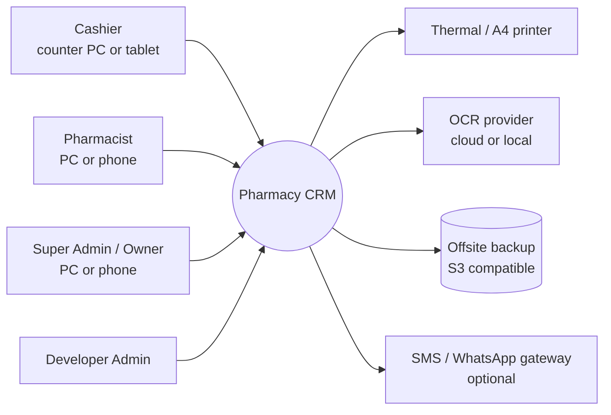
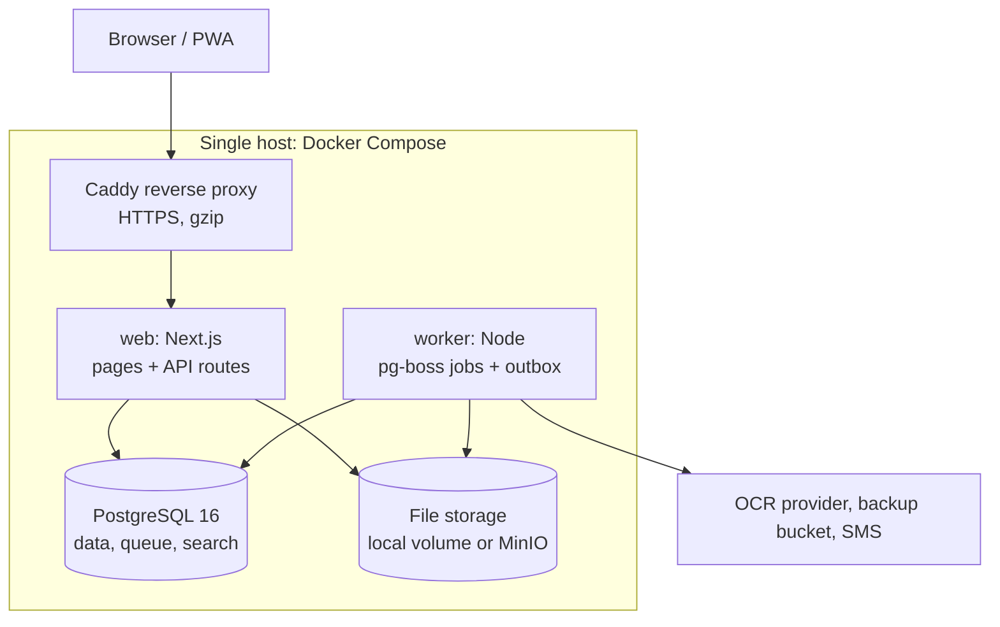
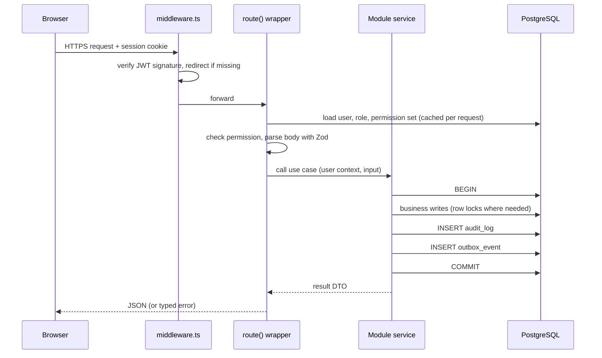
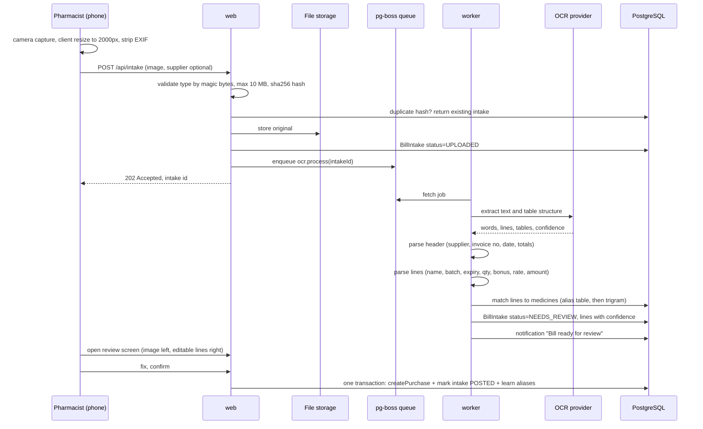
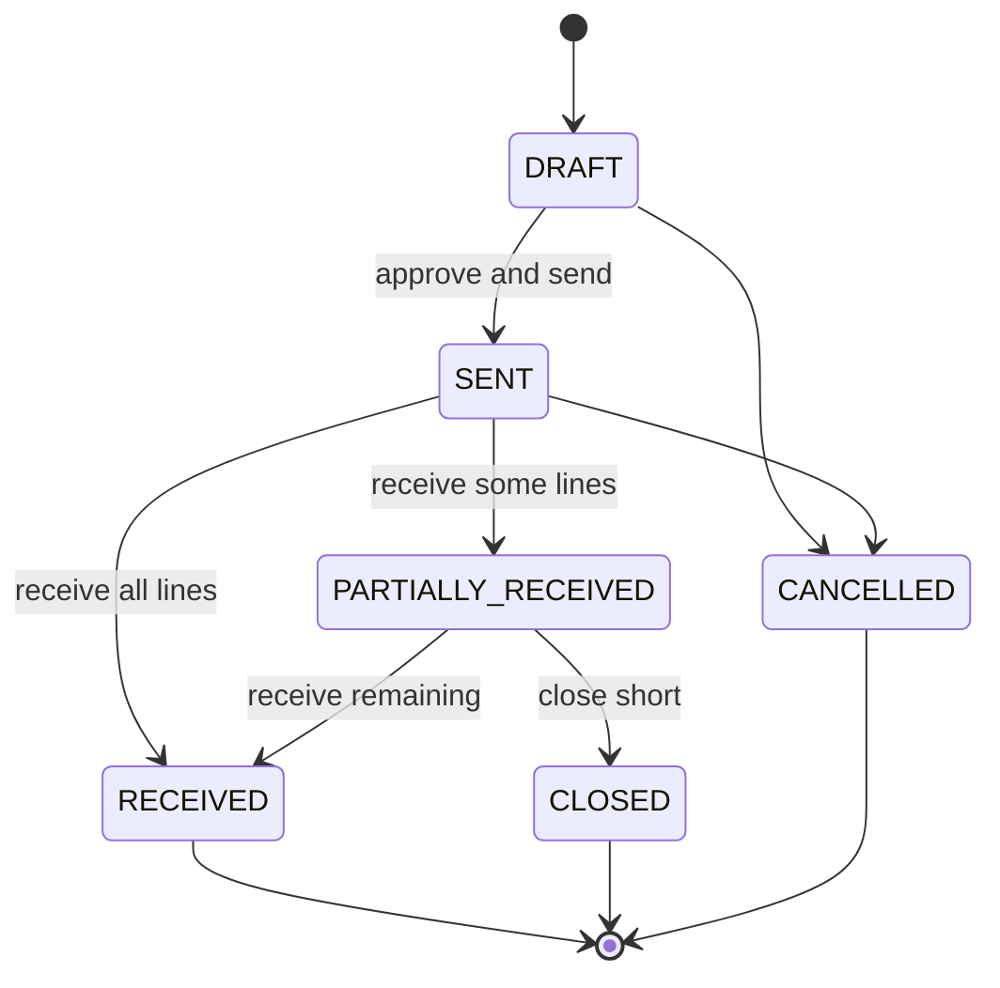

# 02. Architecture and System Design

## 1. Goals and constraints

| Driver | Implication for the design |
|---|---|
| Money and stock must never be wrong | Every write is a single PostgreSQL transaction; database constraints back up application rules; append-only ledgers and movements |
| Small team, small budget | One deployable codebase, one database, no Redis or Kafka. PostgreSQL does storage, queue, search and locking |
| 2 to 15 concurrent users per pharmacy | A single Node process plus one worker is enough. Optimise for latency at the counter, not for scale-out |
| Counter staff are not technical | Fast keyboard-first POS, role-specific screens, clear errors, nothing destructive without confirmation |
| Unreliable internet in some shops | Core flows run on the local network. Cloud services (OCR provider, backups offsite) are optional adapters with fallbacks |
| Owner needs proof of who did what | Audit log on every state change; nothing that touches money is hard-deleted |

## 2. Architecture style: modular monolith

The system stays a **single Next.js application with a separate worker process**, organised into domain modules with strict boundaries.

Why not microservices: the domains share one transaction boundary (a sale touches stock, ledger and cash drawer at once). Splitting them would replace a database transaction with distributed sagas, which adds failure modes without any benefit at this scale. Module boundaries give the same code isolation, and a module can be extracted later if a real need appears.

### 2.1 System context



### 2.2 Containers (deployment units)



| Container | Responsibility | Scaling note |
|---|---|---|
| `web` | UI, REST API, auth, synchronous business transactions | Stateless; can run 2 replicas behind Caddy if ever needed |
| `worker` | OCR processing, scheduled scans (expiry, low stock), notifications, report rollups, backups | One instance; pg-boss guarantees each job runs once |
| `db` | System of record, job queue (pg-boss schema), trigram search (`pg_trgm`) | Daily `pg_dump`, WAL archiving optional |
| `files` | Bill photos, prescription scans, generated PDFs | Adapter: local disk by default, S3/MinIO when offsite is wanted |
| `proxy` | TLS, compression, upload size limit | Automatic certificates with a domain, internal CA on LAN |

The worker is the same codebase started with a different entry point (`node dist/worker.js`), so domain services are shared and never duplicated.

## 3. Code organisation

### 3.1 Target layout

```
src/
  app/                      Next.js routes only (thin)
    (pos)/                  cashier layout: full-screen POS, no sidebar
    (app)/                  back-office layout with sidebar
    api/                    route handlers: parse, authorise, call module, respond
  modules/
    identity/               users, roles, permissions, sessions
    catalog/                medicines, categories, supplier price list
    inventory/              batches, movements, adjustments, expiry
    sales/                  POS sale, invoices, returns, cash sessions, receipts
    customers/              customers, ledger, payments
    procurement/            suppliers, purchase orders, purchases, supplier returns, bill intake (OCR)
    finance/                expenses, profit and loss
    reporting/              report registry, exports, rollups
    notifications/          rules, notification store, delivery channels
    platform/               audit log, outbox, jobs, settings, feature flags, files, backups
  components/               shared UI kit (design tokens, table, form, dialog)
  lib/                      framework glue: prisma client, api wrapper, dates, money
  worker.ts                 worker entry point
```

Each module has the same internal shape:

```
modules/sales/
  index.ts        public API of the module (the only file other modules may import)
  service.ts      use cases, each one a transaction
  schema.ts       Zod input schemas and DTO types
  policy.ts       permission checks beyond simple role gates (e.g. "cashier can reprint only own sales")
  queries.ts      read models for lists and reports
  events.ts       domain events this module emits
  jobs.ts         background job handlers owned by the module
```

### 3.2 Dependency rules

1. `app/` may import any module's `index.ts`, never its internals.
2. Modules may import `lib/` and other modules' `index.ts`. No circular imports (enforced with `eslint-plugin-boundaries` or `dependency-cruiser` in CI).
3. Cross-module side effects that do not have to be in the same transaction go through **domain events**, not direct calls. Example: `sales` emits `SaleCompleted`; `notifications` reacts if stock fell below minimum.
4. Cross-module writes that **must** be atomic (sale plus stock plus ledger) call the other module's service function and pass the transaction client `tx`. Every service function accepts an optional `tx` for this reason.

The existing `src/services/*.ts` files migrate into modules one at a time in Phase 0. The public behaviour and tests stay the same.

## 4. Request lifecycle



Rules:

- **One use case, one transaction.** Audit row and outbox row are written inside the same transaction, so they can never disagree with the data.
- **Idempotency** for retry-prone writes (complete sale, post purchase, receive order): the client sends an `Idempotency-Key` header; the server stores `(key, user, response)` for 24 hours and replays the stored response on a duplicate. Protects against double-clicks and flaky Wi-Fi.
- **Typed errors**: `AppError(status, code, message, fields)`. The UI maps `code` to friendly text and highlights `fields`.

## 5. Identity and access control

### 5.1 Roles from the requirements

| Role | Purpose | Lands on | Key abilities | Cannot |
|---|---|---|---|---|
| **Developer Admin** | Technical owner of the installation | System console | Health, logs, jobs, backups and restore, feature flags, maintenance mode, impersonate for support (logged) | Is hidden from user lists of other roles; cannot be edited or removed by Super Admin |
| **Super Admin** | Pharmacy owner | Owner dashboard | Everything business related: users, roles, prices, reports, net profit, settings | Developer console |
| **Pharmacist** | Runs stock and procurement | Pharmacist dashboard | Medicines, batches, expiry, adjustments, purchase orders, receiving, OCR bill review, returns approval, POS | Users, settings, expenses, net profit (configurable) |
| **Cashier** | Counter sales | POS (full screen) | Sell, take payment, print and reprint own receipts, quick add customer, open and close own cash session | See cost price or profit, cancel invoices, adjust stock, view other cashiers' sessions |

### 5.2 Permission model

- **Permission catalog lives in code** (`identity/permissions.ts`) because each permission is tied to code that checks it. Examples: `pos.sell`, `sales.cancel`, `sales.reprint.any`, `inventory.adjust`, `po.approve`, `ocr.review`, `finance.view`, `cost.view`, `system.console`.
- **Roles live in the database** (`Role` table with a `permissions text[]` column). The four roles above are seeded as `system = true` and cannot be deleted. Super Admin may create custom roles (for example "Senior Cashier" with `sales.cancel`).
- **Sensitive data permissions** such as `cost.view` are applied in queries and DTO mappers, not only in the UI, so cost price and profit never reach a cashier's browser.
- **Session invalidation**: each user has `sessionVersion`. Changing a role, deactivating or resetting a password increments it; the JWT carries the version and is rejected if it is stale. This is a one-column change to the existing check in `getSessionUser`.
- **Re-authentication** (password prompt) for dangerous actions: restore backup, change roles, delete data, approve write-offs above a threshold.
- **Developer impersonation** writes `impersonatedBy` on every audit row produced during the session.

## 6. Key flows

### 6.1 Bill entry with OCR (R4)

The most complex new feature. It is designed as an **intake pipeline that always ends in human review**. OCR never posts stock or money on its own.



Design decisions:

| Concern | Decision |
|---|---|
| OCR provider | `OcrProvider` interface with two adapters. **Cloud adapter** (a document AI service with table extraction or a vision-capable LLM returning structured JSON) for accuracy on dense pharma invoices. **Local adapter** (Tesseract) as offline fallback. Chosen per installation in settings |
| Parsing | Provider output is normalised to a common `ExtractedDocument` shape, then a parser maps columns by header keywords (Qty, Batch, Exp, Rate, Amount, Bonus/Free). Supplier-specific templates can be added when one supplier's layout is consistently misread |
| Medicine matching | 1) exact barcode, 2) `SupplierItemAlias` (text the supplier prints mapped to our medicine, learned from every confirmed review), 3) `pg_trgm` similarity on name and generic name above a threshold, 4) unmatched lines must be mapped or created by the reviewer |
| Validation before posting | Line amount equals qty times rate within tolerance; sum of lines equals invoice total; expiry in the future; batch number present; supplier invoice number unique per supplier |
| Confidence UI | Fields under the confidence threshold are highlighted amber; the confirm button stays disabled until every unmatched line is resolved |
| Idempotency | Image hash stops duplicate uploads; unique `(supplierId, supplierInvoice)` stops posting the same bill twice |
| Link to orders | If the supplier has an open purchase order, the review screen offers "receive against PO-xxxx" and pre-fills ordered quantities |
| Privacy | Images stay in our storage. The cloud adapter sends only the bill image, never customer data |

Intake states: `UPLOADED -> PROCESSING -> NEEDS_REVIEW -> POSTED`, with `FAILED` (retry or enter manually) and `DISCARDED`.

### 6.2 Supplier orders (R12)



- **Reorder suggestions** (worker job, nightly and on demand): for each active medicine, `suggested = max(0, (avgDailySales over 30 days * (leadTimeDays + coverDays)) + minStock - currentStock - openOrderQty)`. Lines are grouped by preferred supplier from `SupplierProduct`, creating one draft PO per supplier.
- **"List of available orders" per supplier**: the supplier page shows open POs with ordered, received and pending quantities, and the expected date.
- **Sending**: printable PO and a WhatsApp share link (text summary). Email optional.
- **Receiving** creates a normal `Purchase` (the existing, tested code path) linked to the PO, with batch and expiry captured at receipt. `PurchaseOrderItem.receivedQty` is updated in the same transaction.
- A PO never changes stock or the supplier ledger. Only receiving does. This keeps one source of truth for stock.

### 6.3 Sale, retail bill and cash session (R6, R8, R15, A2)

- **Cash session**: a cashier opens a session with an opening float before the first cash sale. Every cash sale, refund and cash payment is linked to the open session. Closing records the counted amount; the system shows expected vs counted and the difference, which needs a note above a threshold. Super Admin sees all sessions.
- **Walk-in details**: the sale stores `customerName` and `customerPhone` snapshot fields. If a phone number matches an existing customer, the POS suggests linking. "Save as customer" creates one in the same transaction.
- **Receipt rendering**: one receipt data model, three templates (80 mm thermal, 58 mm thermal, A4). Templates are print CSS with `@page { size: 80mm auto }`; printing uses the browser print dialog or kiosk-mode auto print. A local ESC/POS print agent is a later option if cash drawer kick is needed.
- **Bill content**: pharmacy header, invoice number, date and time, cashier, customer name and phone, lines with batch and expiry, discount, total, paid, change, balance, footer, and a QR code with the invoice number for fast lookup on returns.
- **Returns**: a return references the original sale item and batch, restocks to that batch (unless marked damaged), refunds by cash or credit note, and writes a ledger entry. Partial returns supported.

### 6.4 Expiry and stock alerts (R1, R2)

- A daily job at opening time (`expiry.scan`) finds batches with quantity above zero expiring within `expiryAlertDays` (default **30**, from the notes) and already-expired batches still holding stock.
- Notifications are **de-duplicated per batch and threshold** (30 days, 7 days, expired), so staff get three alerts per batch at most, not one every day.
- Expiring stock options from the alert: mark for return to supplier, discount, or write off as expiry (stock movement `EXPIRY`).
- **Stock card** (R2): per medicine and period: opening balance, purchases in, returns in, sales out, returns out, adjustments, expiry write-off, closing balance. Built from `StockMovement`, which already records every change.

### 6.5 Net profit (R7)

```
Net sales          = sales total - customer returns              (completed only)
COGS               = cost of exact batches sold - cost of returned items restocked
Gross profit       = Net sales - COGS
Stock losses       = damage + expiry write-offs (at cost)
Operating expenses = expenses recorded in the period
Net profit         = Gross profit - Stock losses - Operating expenses
```

Expenses are recorded with a category, amount, date, payment method and optional receipt photo (same file storage). Supplier payments are not expenses; they settle a payable.

## 7. Cross-cutting services

### 7.1 Audit log

`AuditLog(id, at, userId, impersonatedBy, action, entity, entityId, before jsonb, after jsonb, ip, userAgent)`. Written by a helper `audit(tx, ...)` inside the use case transaction. Append-only (database role has no UPDATE or DELETE on the table). Viewer for Super Admin with filters by user, entity and date. Entity pages (invoice, medicine, customer) show their own history tab, which covers R9.

### 7.2 Outbox and events

`OutboxEvent(id, type, payload, createdAt, processedAt)`. The worker polls unprocessed rows every few seconds (or uses `LISTEN/NOTIFY`), dispatches to handlers, marks them processed. At-least-once delivery, so handlers are idempotent. Events: `SaleCompleted`, `SaleCancelled`, `ReturnCreated`, `PurchasePosted`, `StockBelowMinimum`, `BatchExpiring`, `IntakeReady`, `PurchaseOrderOverdue`.

### 7.3 Background jobs (pg-boss)

| Job | Schedule | Purpose |
|---|---|---|
| `ocr.process` | on upload | Run the intake pipeline |
| `expiry.scan` | daily 08:00 local | Expiry notifications |
| `stock.scan` | daily and after sales via event | Low stock notifications |
| `reorder.suggest` | nightly | Draft purchase orders |
| `po.overdue` | daily | Orders past expected date |
| `report.rollup` | hourly | Refresh `DailySummary` for dashboards |
| `backup.nightly` | daily 02:00 | `pg_dump`, compress, copy offsite, keep 14 daily and 12 monthly |
| `files.cleanup` | weekly | Remove discarded intake images after retention period |

pg-boss is chosen because it runs on the existing PostgreSQL. No Redis to install, back up or monitor.

### 7.4 Notifications

`Notification(id, type, severity, title, body, link, audiencePermission, dedupeKey, createdAt)` and `NotificationRead(notificationId, userId, readAt)`. Audience is a permission (for example `inventory.view`), so the right roles see the right alerts without per-user fan-out. Channels: in-app bell (polling every 60 s, upgrade to server-sent events later), daily email or WhatsApp digest to the owner as an optional adapter.

### 7.5 Search

`pg_trgm` GIN indexes on medicine name, generic name, customer name and phone, supplier name. A single `/api/search?q=` endpoint feeds the Ctrl+K command palette and returns grouped results (medicines, customers, invoices, suppliers, pages) filtered by permission. Target p95 below 150 ms.

### 7.6 Reporting

- Report registry: each report is `{ id, permission, params schema, query(params), columns, export formats }`. The existing `/api/reports` switch statement becomes this registry, so adding a report is one file.
- Reads run on the main database with proper indexes. A `DailySummary(date, sales, returns, cogs, discount, purchases, expenses, invoices, ...)` table maintained by the rollup job keeps dashboards fast as data grows. Detail reports always query source tables, so figures can be reconciled.
- All date bucketing uses `APP_TIMEZONE` (`date_trunc` on `createdAt AT TIME ZONE tz`).
- Exports: CSV (existing), Excel via `exceljs`, PDF via print stylesheet (browser "Save as PDF") first, server-rendered PDF later if needed.

### 7.7 File storage

`StorageAdapter { put, get, signedUrl, delete }`. Local adapter writes to a Docker volume; S3 adapter works with MinIO, Cloudflare R2 or AWS. Files are served through an API route that checks permission, never from a public folder. Uploads are validated by magic bytes, size-limited and stored under random keys.

## 8. Security

| Area | Measure |
|---|---|
| Framework | Upgrade Next.js 14.2.15 to the latest patched 14.2.x immediately (published advisory), evaluate Next 15 in a later phase |
| Sessions | httpOnly, SameSite Lax, Secure in production, `sessionVersion` revocation, 8 hour expiry with sliding refresh for active POS |
| CSRF | Existing JSON-only body rule plus an `Origin` header check on all non-GET API requests |
| Rate limits | Move from in-memory to a PostgreSQL table so limits survive restarts and multiple replicas |
| Passwords | bcrypt cost 12, minimum length 10, forced change on first login for seeded or reset accounts |
| Uploads | Magic byte check, size limit at proxy and app, images re-encoded server-side, no SVG |
| Data exposure | DTO mappers strip cost fields without `cost.view` |
| Secrets | `.env` never committed; Docker secrets for production; JWT secret rotation supported by keeping previous key for verification |
| Dependencies | `npm audit` and Dependabot in CI; the Docker image runs as non-root |
| Backups | Encrypted at rest offsite; restore tested monthly from the developer console |

## 9. Non-functional targets

| Metric | Target |
|---|---|
| POS medicine search | p95 below 150 ms on 20k medicines |
| Complete sale | p95 below 500 ms for 10 lines |
| Dashboard load | below 1.5 s on a mid-range laptop |
| OCR turnaround | below 30 s per bill with the cloud adapter |
| Recovery point | at most 24 h (nightly backup), at most 5 min with optional WAL archiving |
| Recovery time | below 1 h by documented restore |
| Accessibility | WCAG 2.2 AA for all screens |

Future proofing without building it now:

- **Multi-branch**: all new tables get no branch column yet, but stock queries go through inventory module functions only, so adding `branchId` later changes one module rather than every screen.
- **Offline POS**: the PWA shell caches the medicine list; true offline selling (queue sales, sync later) is a separate project because it needs conflict rules for stock. Not planned.

## 10. Architecture decision records (summary)

| # | Decision | Alternatives considered | Reason |
|---|---|---|---|
| ADR-1 | Modular monolith, Next.js plus worker | Microservices, separate Express API | One transaction boundary, one deploy, small team |
| ADR-2 | PostgreSQL for queue (pg-boss) and search (pg_trgm) | Redis plus BullMQ, Elasticsearch | Fewer moving parts, same backup covers everything |
| ADR-3 | Permission catalog in code, roles in database | Hard-coded roles, full ABAC | Owner can create roles; checks remain type-safe |
| ADR-4 | OCR behind an adapter, mandatory human review | Fully automatic posting | OCR errors on pharma bills are common; wrong stock is worse than slow entry |
| ADR-5 | Purchase orders never move stock; receiving reuses `createPurchase` | Stock reserved on order | Single tested path for stock in |
| ADR-6 | Transactional outbox for side effects | Calling notifications inline | Side effects never fail a sale and never get lost |
| ADR-7 | Browser print with CSS templates for receipts | ESC/POS agent from day one | Works on any printer with no install; agent can be added later |
| ADR-8 | Append-only audit log in the same transaction | Database triggers | Captures user intent and context, not only row diffs |
