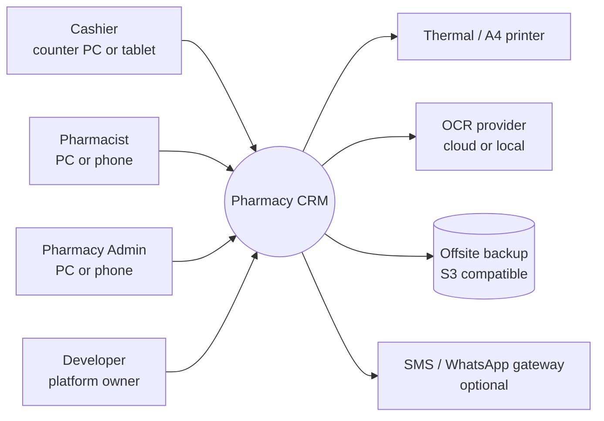
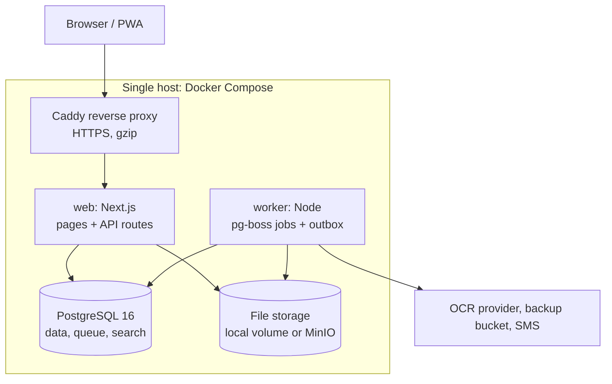
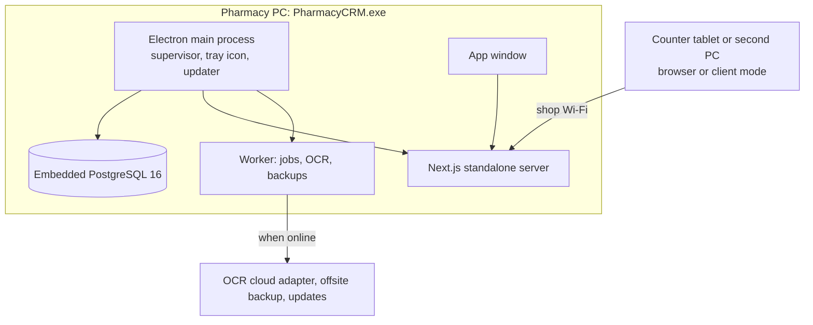
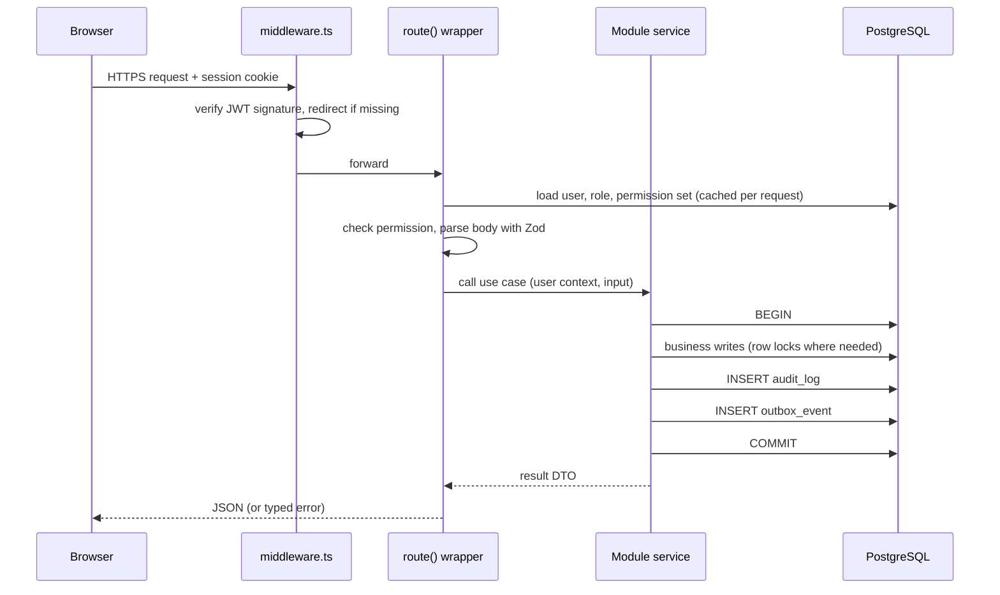
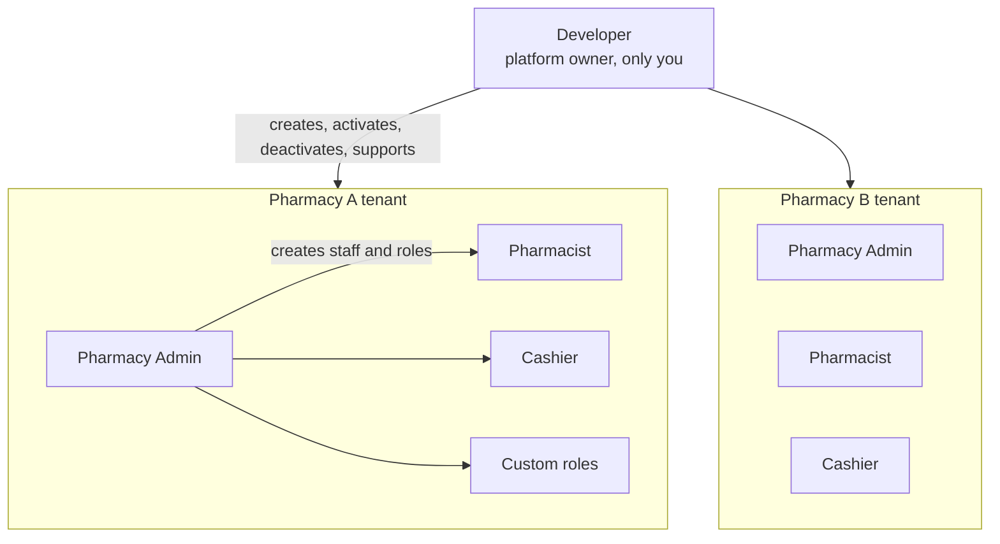
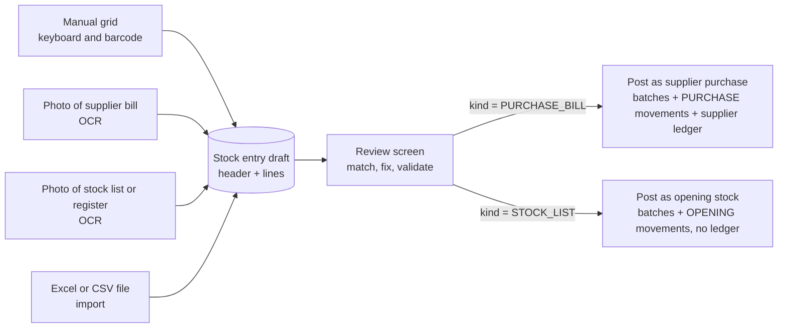
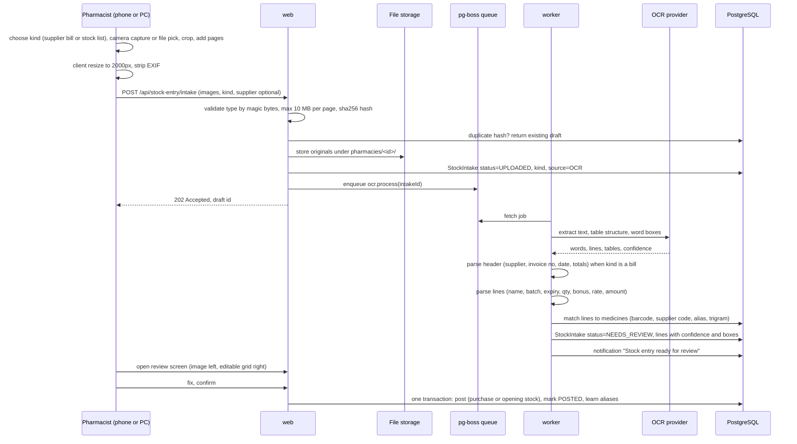
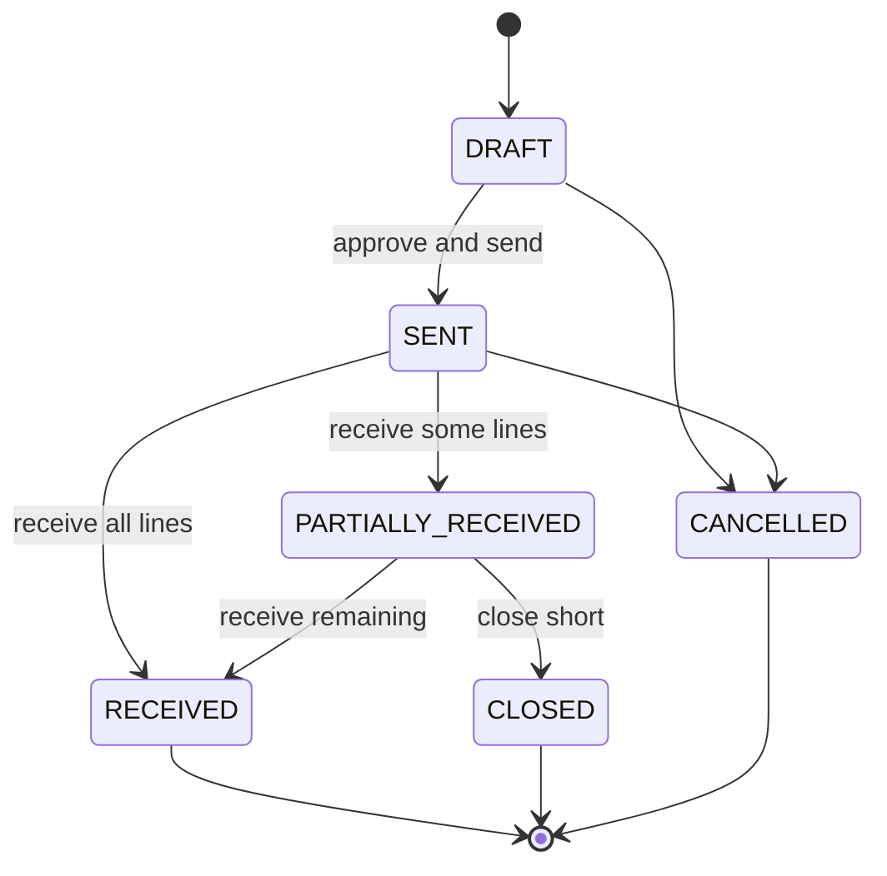

# 02. Architecture and System Design

## 1. Goals and constraints

| Driver | Implication for the design |
|---|---|
| Money and stock must never be wrong | Every write is a single PostgreSQL transaction; database constraints back up application rules; append-only ledgers and movements |
| Small team, small budget | One deployable codebase, one database, no Redis or Kafka. PostgreSQL does storage, queue, search and locking |
| Many pharmacies on one platform, 2 to 15 staff each | Shared database with strict tenant isolation (section 5.2). One web process and one worker serve dozens of pharmacies; add web replicas as the number grows |
| One owner runs the platform | Developer console for onboarding, suspension, credentials and support, so no database access is needed for daily operations |
| Counter staff are not technical | Fast keyboard-first POS, role-specific screens, clear errors, nothing destructive without confirmation |
| Unreliable internet in some shops | Core flows run on the local network. Cloud services (OCR provider, backups offsite) are optional adapters with fallbacks |
| Owner needs proof of who did what | Audit log on every state change; nothing that touches money is hard-deleted |

## 2. Architecture style: modular monolith

The system stays a **single Next.js application with a separate worker process**, organised into domain modules with strict boundaries.

Why not microservices: the domains share one transaction boundary (a sale touches stock, ledger and cash drawer at once). Splitting them would replace a database transaction with distributed sagas, which adds failure modes without any benefit at this scale. Module boundaries give the same code isolation, and a module can be extracted later if a real need appears.

### 2.1 System context



### 2.2 Containers (deployment units)



| Container | Responsibility | Scaling note |
|---|---|---|
| `web` | UI, REST API, auth, synchronous business transactions | Stateless; can run 2 replicas behind Caddy if ever needed |
| `worker` | OCR processing, scheduled scans (expiry, low stock), notifications, report rollups, backups | One instance; pg-boss guarantees each job runs once |
| `db` | System of record, job queue (pg-boss schema), trigram search (`pg_trgm`) | Daily `pg_dump`, WAL archiving optional |
| `files` | Bill and stock list photos, pharmacy logos, generated PDFs | Adapter: local disk by default, S3/MinIO when offsite is wanted |
| `proxy` | TLS, compression, upload size limit | Automatic certificates with a domain, internal CA on LAN |

The worker is the same codebase started with a different entry point (`node dist/worker.js`), so domain services are shared and never duplicated.

### 2.3 Deployment modes: desktop installer and server

The same codebase ships in two ways. Business code does not know which mode it runs in; only the start-up layer differs.

| | Desktop mode (Windows installer) | Server mode (Docker) |
|---|---|---|
| Delivered as | `PharmacyCRM-Setup-x.y.z.exe` (NSIS installer built with electron-builder) | `docker compose up` on a VPS or a shop server |
| Typical use | One pharmacy PC runs everything, works without internet; other counter devices on the shop Wi-Fi connect to it | The Developer hosts many pharmacies centrally |
| Database | Embedded PostgreSQL 16 (bundled binaries), data in `%PROGRAMDATA%\PharmacyCRM\pgdata` | PostgreSQL 16 container |
| Web and worker | Next.js standalone server and the worker started as child processes by the Electron main process | `web` and `worker` containers |
| UI | Electron window loading `http://127.0.0.1:<port>`; other devices use the browser or the same app in client mode | Browser or installed PWA |
| Backups | `pg_dump` (bundled) to a chosen folder, USB drive or synced cloud folder, plus offsite upload when online | Nightly job to offsite storage |
| Updates | `electron-updater` from a release feed; automatic backup before every update; migrations run on start | New image, migrations on start |



Design decisions:

| Concern | Decision |
|---|---|
| Shell | **Electron**. It ships its own Node runtime, so the existing Next.js server, Prisma and pg-boss run unchanged. Tauri would need a separate Node sidecar binary and gives no benefit for a server-shaped app |
| Database | Real PostgreSQL, not SQLite, so Row-Level Security, `pg_trgm`, pg-boss and every migration behave exactly as on the server. The `embedded-postgres` package provides the Windows binaries; the major version is pinned to 16 |
| First start | The main process initialises the data directory, generates a random superuser password protected with Windows DPAPI (Electron `safeStorage`), creates `app_owner`, `app_user` and `platform_user`, runs migrations, then starts the web server and worker. A splash screen shows progress |
| Developer account on a desktop install | The installer build embeds the owner email and a bcrypt hash of the owner password, taken from build-time secrets that never enter the repository. First login forces TOTP enrolment. Anyone else who installs the exe cannot become Developer; recovery is `PharmacyCRM.exe --recover-owner`, which requires a Windows administrator |
| After install | The Developer logs in, creates the pharmacy and its admin exactly as in server mode (section 6.7). One installation can host one or several pharmacies |
| Remote control | None. Each installation has its own local Developer console; the Developer manages it on site. A cloud control plane was considered and left out of scope |
| Client mode | The same installer offers "This computer runs the pharmacy" or "Connect to a pharmacy server" (LAN address or cloud URL). Client mode is only the window, with no database or server |
| LAN access | Off by default (server binds to `127.0.0.1`). When the Pharmacy Admin enables it, the server binds to the LAN interface, the installer's firewall rule opens the port for private networks only, and the address is shown as a QR code for tablets |
| Ports | Picks a free local port at start; PostgreSQL listens on `127.0.0.1` only, never on the LAN |
| OCR offline | Local Tesseract adapter works without internet; the cloud adapter is used when online and allowed |
| Code signing | Installer and app signed with an Authenticode certificate so Windows SmartScreen does not block it |
| Size | Roughly 300 MB installed (Electron, PostgreSQL binaries, app). Acceptable for a PC that runs a shop |
| Mode switch | `DEPLOY_MODE=desktop` or `server`. The only mode-specific code is in `desktop/` (Electron main, supervisor, updater) and in `platform/` start-up (owner bootstrap source, backup target) |

## 3. Code organisation

### 3.1 Target layout

```
src/
  app/                      Next.js routes only (thin)
    (platform)/             Developer console: pharmacies, accounts, system
    (pos)/                  cashier layout: full-screen POS, no sidebar
    (app)/                  back-office layout with sidebar
    api/                    route handlers: parse, authorise, call module, respond
  modules/
    tenancy/                pharmacies, status, subscription, branding, onboarding, counters
    identity/               platform users, staff, roles, permissions, sessions, tokens, 2FA
    catalog/                medicines, categories, supplier price list
    inventory/              batches, movements, adjustments, expiry
    sales/                  POS sale, invoices, returns, cash sessions, receipts
    customers/              customers, ledger, payments
    procurement/            suppliers, supplier catalog, purchase orders, purchases, supplier returns
    stockentry/             stock entry drafts: manual grid, OCR pipeline, file import, review and posting
    finance/                expenses, profit and loss
    reporting/              report registry, exports, rollups
    notifications/          rules, notification store, delivery channels
    platform/               audit log, outbox, jobs, settings, feature flags, files, backups
  components/               shared UI kit (design tokens, table, form, dialog)
  lib/                      framework glue: prisma client, api wrapper, dates, money
  worker.ts                 worker entry point
desktop/                    Electron main process: supervisor, embedded PostgreSQL, updater, tray (desktop mode only)
```

Each module has the same internal shape:

```
modules/sales/
  index.ts        public API of the module (the only file other modules may import)
  service.ts      use cases, each one a transaction
  schema.ts       Zod input schemas and DTO types
  policy.ts       permission checks beyond simple role gates (e.g. "cashier can reprint only own sales")
  queries.ts      read models for lists and reports
  events.ts       domain events this module emits
  jobs.ts         background job handlers owned by the module
```

### 3.2 Dependency rules

1. `app/` may import any module's `index.ts`, never its internals.
2. Modules may import `lib/` and other modules' `index.ts`. No circular imports (enforced with `eslint-plugin-boundaries` or `dependency-cruiser` in CI).
3. Cross-module side effects that do not have to be in the same transaction go through **domain events**, not direct calls. Example: `sales` emits `SaleCompleted`; `notifications` reacts if stock fell below minimum.
4. Cross-module writes that **must** be atomic (sale plus stock plus ledger) call the other module's service function and pass the transaction client `tx`. Every service function accepts an optional `tx` for this reason.

The original `src/services/*.ts` files were moved into modules in Phase 0 (task 0.3) with no change in behaviour. Route handlers that still query Prisma directly move into their module as each feature is touched.

## 4. Request lifecycle



Rules:

- **Tenant context first.** The route wrapper takes `pharmacyId` from the session (staff realm) or from the support session (Developer), checks the pharmacy status, and the use case runs inside `withTenant(pharmacyId, ...)`. There is no code path that reaches tenant tables without it.
- **One use case, one transaction.** Audit row and outbox row are written inside the same transaction, so they can never disagree with the data.
- **Idempotency** for retry-prone writes (complete sale, post purchase, receive order): the client sends an `Idempotency-Key` header; the server stores `(key, user, response)` for 24 hours and replays the stored response on a duplicate. Protects against double-clicks and flaky Wi-Fi.
- **Typed errors**: `AppError(status, code, message, fields)`. The UI maps `code` to friendly text and highlights `fields`.

## 5. Tenancy, identity and access

### 5.1 Platform model

The product is a **platform that hosts many pharmacies**. There are two levels of account, and the upper level can see everything below it. Customers are records kept by staff, not accounts.



| Level | Who | Sees |
|---|---|---|
| Platform | Developer (the product owner) | Every pharmacy, every account, system health |
| Pharmacy (tenant) | Pharmacy Admin, Pharmacist, Cashier, custom roles | Only their own pharmacy's data |

### 5.2 Tenant isolation

| Option | Isolation | Cost to run | Cross-pharmacy reporting for the Developer | Verdict |
|---|---|---|---|---|
| Database per pharmacy | Strongest | High: N databases to migrate, back up and monitor | Hard | Too heavy for many small pharmacies |
| Schema per pharmacy | Strong | Medium: N schemas per migration, Prisma support is awkward | Hard | Migration pain grows with every customer |
| **Shared schema, `pharmacyId` column, PostgreSQL Row-Level Security** | Strong when RLS is enforced | Low: one database, one migration | Easy | **Chosen** |

How it is enforced, in layers, so one mistake is not enough to leak data:

1. **Column**: every tenant table has `pharmacyId uuid not null` with a foreign key to `Pharmacy`. It is the first column of every composite index and every business unique key (`(pharmacyId, invoiceNo)`, `(pharmacyId, barcode)`).
2. **Tenant-scoped database access**: services never import the global Prisma client. They receive a tenant context and run inside `withTenant(pharmacyId, (tx) => ...)`, which opens a transaction and first executes `select set_config('app.pharmacy_id', $1, true)` (transaction-local).
3. **Row-Level Security**: every tenant table has a policy `USING ("pharmacyId" = current_setting('app.pharmacy_id', true)::uuid)` with the same `WITH CHECK`. If the setting is missing the comparison is null and **no rows match**, so a forgotten context fails closed instead of leaking.
4. **Database roles**: the web app connects as `app_user`, which does not own the tables and has no `BYPASSRLS`. Migrations run as `app_owner`. Only the platform module uses a separate `platform_user` connection with `BYPASSRLS`, for Developer screens that list across pharmacies.
5. **Everything else carries the tenant**: file keys are prefixed `pharmacies/<id>/`, job payloads include `pharmacyId`, scheduled jobs fan out per active pharmacy, search and caches are keyed by pharmacy.
6. **Per-pharmacy numbering**: global PostgreSQL sequences are replaced by a `TenantCounter(pharmacyId, key, value)` row updated with `UPDATE ... SET value = value + 1 RETURNING value`. Each pharmacy gets its own `INV-...00001` series, and the row lock only serialises sales inside the same pharmacy.
7. **Isolation test suite**: two seeded pharmacies; every API endpoint is called with pharmacy A's session using pharmacy B's record ids and must return 404. Runs in CI on every commit.

### 5.3 Identity realms

Two kinds of account live in two separate tables, log in on separate pages and receive separate cookies. A bug in the pharmacy app therefore cannot produce a Developer session.

| Realm | Table | Login page | Credentials | Cookie | Session |
|---|---|---|---|---|---|
| Platform | `PlatformUser` | `/platform/login` | Email, password, **TOTP code (mandatory)** | `pcrm_platform` | 2 h, sliding |
| Staff | `User` (has `pharmacyId`) | `/p/<pharmacy-slug>/login` (shows the pharmacy logo) or `/login` with a pharmacy code remembered on the device | Username, password, optional TOTP | `pcrm_staff` | 8 h, sliding while active |

Each realm has its own route wrapper (`platformRoute`, `staffRoute`) built on the existing `route()` helper. The JWT carries `realm`, `sub`, `pharmacyId` (staff) and `sessionVersion`; a token from one realm is rejected by the others.

Usernames are unique inside a pharmacy, so two pharmacies can both have a user called `ali`.

### 5.4 Roles

| Role | Level | Created by | Can do | Cannot do |
|---|---|---|---|---|
| **Developer** | Platform | Server environment on first boot only | Everything. Create pharmacies and their admin credentials; activate, suspend, deactivate pharmacies; activate and deactivate any user; issue reset and invite links for anyone; force logout; support access into any pharmacy with full permissions; feature flags and limits per pharmacy; subscription dates; data export; system console (health, jobs, logs, backups, maintenance) | Nothing is restricted. The account itself cannot be removed or demoted by anyone |
| **Pharmacy Admin** | Pharmacy | Developer (first admin), then other Pharmacy Admins | All access inside the pharmacy: profile and branding (name, logo, contacts, receipt text), custom roles, staff accounts and passwords, customers, prices, reports, net profit, settings, audit log | See other pharmacies or the platform console; remove the last active Pharmacy Admin |
| **Pharmacist** | Pharmacy | Pharmacy Admin | Dashboard, medicines and batches, **supplier catalogs (add medicines for each supplier)**, **stock entry (manual and OCR) and review**, purchase orders and receiving, expiry and stock adjustments, approve returns, POS | Staff, roles, branding, expenses and net profit (unless granted) |
| **Cashier** | Pharmacy | Pharmacy Admin | POS, cash and card payments, print and reprint own receipts, quick add customer, own cash session; optionally upload stock entry photos for a pharmacist to review | Cost price and profit, cancellations, stock changes, other cashiers' sessions |
| **Custom role** | Pharmacy | Pharmacy Admin | Any subset of tenant permissions, for example "Senior Cashier" with cancellations | Platform permissions (they are not in the tenant catalog) |

**Why the Developer role is permanent ("always with me")**:

- Developer accounts live only in `PlatformUser`. No API endpoint creates, deactivates, demotes or deletes a `PlatformUser`; the only self-service is changing your own password and 2FA device.
- The first account is created on boot from `PLATFORM_OWNER_EMAIL` and `PLATFORM_OWNER_PASSWORD` when the table is empty. After that the variables are ignored.
- Recovery when the password or 2FA device is lost is a server command, `npm run platform:recover-owner`, which needs shell access to the server. Nobody with only a browser can take the role over.
- Every Developer action is audited. Support access into a pharmacy shows a banner to the Developer and appears in that pharmacy's audit log as "Platform support", which builds trust with pharmacy owners.

### 5.5 Permission model

- **Two catalogs in code**: tenant permissions (`pos.sell`, `sales.cancel`, `cost.view`, `supplierCatalog.manage`, `stockEntry.create`, `stockEntry.post`, `roles.manage`, `branding.manage`, ...) and platform permissions (`platform.pharmacies.manage`, `platform.users.manage`, `platform.support`, `platform.system`). Tenant roles can only contain tenant permissions.
- **Role templates**: Pharmacy Admin, Pharmacist and Cashier are global system templates (`pharmacyId` null, read-only). Custom roles belong to one pharmacy. "Duplicate role" copies a template into an editable custom role.
- **No privilege escalation**: a user can only grant permissions they hold themselves, and only Pharmacy Admins can edit roles.
- **Sensitive data permissions** such as `cost.view` are applied in queries and DTO mappers, so cost price and profit never reach a cashier's browser.
- **Session invalidation**: `sessionVersion` on every account. Role change, deactivation, password reset or "force logout" increments it and all existing sessions die on their next request. Suspending a pharmacy blocks all its staff sessions the same way.
- **Re-authentication** for dangerous actions: changing roles, issuing a reset link for a Pharmacy Admin, deactivating a pharmacy, restoring a backup.

### 5.6 Credential lifecycle

```mermaid
sequenceDiagram
  participant D as Developer
  participant P as Platform console
  participant DB as PostgreSQL
  participant A as New Pharmacy Admin

  D->>P: Create pharmacy (name, slug, contacts) + admin (name, username, phone/email)
  P->>DB: one transaction: Pharmacy, settings, counters, default categories, admin user (no password), invite token hash
  P-->>D: invite link shown once: Copy / Share on WhatsApp / Send email
  D->>A: shares link
  A->>P: opens /invite/<token>, sets password (and 2FA if enabled)
  P->>DB: verify hash, unused, not expired; set password; mark token used
  A->>P: first-run wizard: logo, details, receipt format, staff, import medicines
```

| Mechanism | Rule |
|---|---|
| Invite link | 32 random bytes, only the SHA-256 hash is stored, valid 72 h, single use. Used for new pharmacies and new staff |
| Temporary password | Alternative to an invite: a strong generated password shown once, `mustChangePassword` forces a change at first login |
| Reset link | Same token mechanism with purpose `RESET`, valid 1 h. Issuing a new link revokes older unused ones. Using it bumps `sessionVersion` so every old session ends |
| Who can issue | Developer: anyone. Pharmacy Admin: staff of their pharmacy |
| Forgot password (self-service) | Staff: request appears as a notification to the Pharmacy Admin, who issues a link (many staff have no email). Email self-service works automatically when an email adapter is configured |
| Delivery | Link is always copyable; WhatsApp share uses a `wa.me` URL with prefilled text; email through an adapter (SMTP or a transactional email service). SMS later through an adapter |
| Lockout | Rate limit per account and per IP; Developer and Pharmacy Admin can unlock |

Pharmacy status and its effects:

| Status | Staff login | Data | Developer access | Typical cause |
|---|---|---|---|---|
| `ACTIVE` | Allowed | Read and write | Yes | Normal |
| `GRACE` | Allowed with a payment banner | Read and write | Yes | Subscription ended less than N days ago |
| `SUSPENDED` | Blocked with a message showing the pharmacy's contact for the platform | Kept, read-only to Developer | Yes | Non-payment or Developer decision |
| `DEACTIVATED` | Blocked | Kept, hidden from lists, exportable | Yes | Pharmacy left the platform; can be reactivated |

Data is never hard-deleted by status changes. Permanent deletion is a separate Developer action with a typed confirmation and a final export.

## 6. Key flows

### 6.1 Stock entry: manual and OCR (R4, R26)

Stock entry is a **must-have core workflow**. Every way of bringing stock in (typing it, photographing a supplier bill, photographing a stock list, importing a file) produces the same thing: a **stock entry draft** with lines. Every draft goes through the same review screen and posts through the existing, tested stock-in code. That gives one set of validation rules, one review experience, and one place to fix bugs.



| Kind | Typical use | Supplier | Posts as |
|---|---|---|---|
| `PURCHASE_BILL` | Daily: goods arrive with a distributor bill | Required | `createPurchase`: batches created or topped up, `PURCHASE` movements, supplier ledger debit, optional payment, optional purchase order receipt |
| `STOCK_LIST` | Onboarding a pharmacy, or a stock count from a register | None | Opening batches with `OPENING` movements; no ledger; cost taken from the line rate |

#### 6.1.1 Manual entry (fast grid)

Manual entry stays first class, because OCR will not read every bill and some staff will prefer typing.

- Spreadsheet-like grid, fully keyboard driven: medicine (type-ahead search on name, generic and barcode; a barcode scan fills the cell), batch, expiry (`MM/YY` typed, stored as month end), quantity, bonus, rate, discount percent, tax, line amount (calculated, editable for rounding).
- Enter or Tab moves to the next cell; a new row appears automatically; Ctrl+D copies the cell above (handy for the same expiry on many lines).
- Header: supplier (remembers the last one), supplier invoice number, bill date, bill total. The grid shows lines total against bill total live.
- **Drafts save to the server every few seconds**, so a phone call or a power cut does not lose a half-typed bill. Drafts are listed under "Stock entry > Drafts" and can be finished by another user with the same permission.
- Warnings, not blocks, for: rate more than 10 percent different from the last purchase price, expiry within 90 days, batch number already received from a different supplier, sale price below cost.
- Blocks for: expiry in the past, missing batch number, duplicate supplier invoice number for the same supplier, quantity not positive.
- "New medicine" from inside the grid opens a small inline form, so an unknown item never forces the user to leave the bill.

#### 6.1.2 OCR from a photo

The OCR pipeline fills the same draft automatically. It **always ends in human review**; OCR never posts stock or money on its own.



Design decisions:

| Concern | Decision |
|---|---|
| OCR provider | `OcrProvider` interface with two adapters. **Cloud adapter** (a document recognition service with table extraction, or a vision-capable model returning structured JSON) for accuracy on dense printed bills and on handwriting. **Local adapter** (Tesseract) as offline fallback for clean printed bills. The Developer decides which adapters a pharmacy may use |
| Handwritten stock lists | Much harder than printed bills. The cloud adapter is required for them; the review screen expects more corrections; the parser accepts loose formats ("Panadol 20 exp 3/27") |
| Parsing | Provider output is normalised to one `ExtractedDocument` shape, then a parser maps columns by header keywords (Qty, Batch, Exp, Rate, Amount, Bonus/Free, Disc, GST). Supplier-specific templates can be added when one supplier's layout is consistently misread |
| Medicine matching | 1) exact barcode, 2) supplier code from the supplier catalog, 3) `SupplierItemAlias` (text the supplier prints, learned from every confirmed review), 4) `pg_trgm` similarity on name and generic name above a threshold, 5) unmatched lines are mapped or created by the reviewer in the grid |
| Validation before posting | Same rules as manual entry (6.1.1), plus: line amount equals qty times rate less discount within tolerance; lines total equals bill total |
| Confidence UI | Cells under the confidence threshold are amber; selecting a row highlights its region on the photo; Post stays disabled until every line is matched |
| Idempotency | Image hash stops duplicate uploads; unique `(pharmacyId, supplierId, supplierInvoice)` stops posting the same bill twice |
| Link to orders | For a supplier bill with an open purchase order, the review screen offers "receive against PO-xxxx" and compares quantities |
| Privacy | Photos stay in the platform's storage. The cloud adapter receives only the photo, never customer data |
| Cost control | OCR calls are counted per pharmacy; the Developer can set a monthly limit per plan |

Draft states: `DRAFT` (manual, being typed) or `UPLOADED -> PROCESSING -> NEEDS_REVIEW`, then `POSTED`, with `FAILED` (retry, or continue manually in the same grid) and `DISCARDED`.

### 6.2 Supplier orders (R12)



- **Reorder suggestions** (worker job, nightly and on demand): for each active medicine, `suggested = max(0, (avgDailySales over 30 days * (leadTimeDays + coverDays)) + minStock - currentStock - openOrderQty)`. Lines are grouped by preferred supplier from `SupplierProduct`, creating one draft PO per supplier.
- **"List of available orders" per supplier**: the supplier page shows open POs with ordered, received and pending quantities, and the expected date.
- **Sending**: printable PO and a WhatsApp share link (text summary). Email optional.
- **Receiving** opens a stock entry draft pre-filled from the PO (section 6.1) and posts a normal `Purchase` (the existing, tested code path) linked to the PO, with batch and expiry captured at receipt. `PurchaseOrderItem.receivedQty` is updated in the same transaction.
- A PO never changes stock or the supplier ledger. Only receiving does. This keeps one source of truth for stock.

### 6.3 Sale, retail bill and cash session (R6, R8, R15, A2)

- **Cash session**: a cashier opens a session with an opening float before the first cash sale. Every cash sale, refund and cash payment is linked to the open session. Closing records the counted amount; the system shows expected vs counted and the difference, which needs a note above a threshold. Pharmacy Admin sees all sessions of the pharmacy.
- **Walk-in details**: the sale stores `customerName` and `customerPhone` snapshot fields. If a phone number matches an existing customer, the POS suggests linking. "Save as customer" creates one in the same transaction.
- **Receipt rendering**: one receipt data model, three templates (80 mm thermal, 58 mm thermal, A4). Templates are print CSS with `@page { size: 80mm auto }`; printing uses the browser print dialog or kiosk-mode auto print. A local ESC/POS print agent is a later option if cash drawer kick is needed.
- **Bill content**: pharmacy header, invoice number, date and time, cashier, customer name and phone, lines with batch and expiry, discount, total, paid, change, balance, footer, and a QR code with the invoice number for fast lookup on returns.
- **Returns**: a return references the original sale item and batch, restocks to that batch (unless marked damaged), refunds by cash or credit note, and writes a ledger entry. Partial returns supported.

### 6.4 Expiry and stock alerts (R1, R2)

- A daily job at opening time (`expiry.scan`) finds batches with quantity above zero expiring within `expiryAlertDays` (default **30**, from the notes) and already-expired batches still holding stock.
- Notifications are **de-duplicated per batch and threshold** (30 days, 7 days, expired), so staff get three alerts per batch at most, not one every day.
- Expiring stock options from the alert: mark for return to supplier, discount, or write off as expiry (stock movement `EXPIRY`).
- **Stock card** (R2): per medicine and period: opening balance, purchases in, returns in, sales out, returns out, adjustments, expiry write-off, closing balance. Built from `StockMovement`, which already records every change.

### 6.5 Net profit (R7)

```
Net sales          = sales total - customer returns              (completed only)
COGS               = cost of exact batches sold - cost of returned items restocked
Gross profit       = Net sales - COGS
Stock losses       = damage + expiry write-offs (at cost)
Operating expenses = expenses recorded in the period
Net profit         = Gross profit - Stock losses - Operating expenses
```

Expenses are recorded with a category, amount, date, payment method and optional receipt photo (same file storage). Supplier payments are not expenses; they settle a payable.

### 6.6 Supplier catalog (R25)

- `SupplierProduct` links a supplier to the medicines it supplies, with supplier code, pack size, last price, bonus rule (for example "10+1"), lead time and a preferred flag.
- **Pharmacists maintain it** from the supplier page: search and add existing medicines, or create a new medicine inline (name, generic, category, unit, prices, barcode) and link it in one step. Bulk import from a supplier price list (CSV or Excel) with a preview and error report.
- Posting a purchase updates `lastPrice` automatically, so the list stays current without manual work.
- Used by reorder suggestions (which supplier to order from), by purchase order forms (only that supplier's medicines are offered first) and by OCR matching (supplier codes printed on bills).

### 6.7 Pharmacy onboarding (R18, R21)

1. Developer opens the platform console, "New pharmacy": name, URL slug, owner name, phone, email, city, licence number, plan and subscription end date.
2. One transaction creates the pharmacy, its settings with defaults, counters, default expense categories, and the first Pharmacy Admin with an invite link (or temporary password).
3. Pharmacy Admin opens the link, sets a password, and is taken to a **first-run wizard**: profile and logo, receipt format and footer, staff accounts, opening stock (Excel import or OCR of a stock list photo, section 6.1), import customers.
4. The pharmacy appears on the Developer's dashboard with usage (users, invoices this month, storage, last activity) and status.
5. Branding (R21) can be changed any time by the Pharmacy Admin: display name, logo (PNG or JPG, resized server-side to 512 px and 128 px versions), address, phones, email, licence and tax numbers, receipt header and footer, brand colour. Branding appears on the staff app header, the login page, receipts and purchase orders.

## 7. Cross-cutting services

### 7.1 Audit log

`AuditLog(id, at, userId, impersonatedBy, action, entity, entityId, before jsonb, after jsonb, ip, userAgent)`. Written by a helper `audit(tx, ...)` inside the use case transaction. Append-only (database role has no UPDATE or DELETE on the table). Viewer for Pharmacy Admin (own pharmacy) and Developer (all pharmacies) with filters by user, entity and date. Entity pages (invoice, medicine, customer) show their own history tab, which covers R9.

### 7.2 Outbox and events

`OutboxEvent(id, type, payload, createdAt, processedAt)`. The worker polls unprocessed rows every few seconds (or uses `LISTEN/NOTIFY`), dispatches to handlers, marks them processed. At-least-once delivery, so handlers are idempotent. Events: `SaleCompleted`, `SaleCancelled`, `ReturnCreated`, `PurchasePosted`, `StockBelowMinimum`, `BatchExpiring`, `IntakeReady`, `PurchaseOrderOverdue`.

### 7.3 Background jobs (pg-boss)

| Job | Schedule | Purpose |
|---|---|---|
| `ocr.process` | on upload | Run the intake pipeline |
| `expiry.scan` | daily 08:00 local | Expiry notifications |
| `stock.scan` | daily and after sales via event | Low stock notifications |
| `reorder.suggest` | nightly | Draft purchase orders |
| `po.overdue` | daily | Orders past expected date |
| `report.rollup` | hourly | Refresh `DailySummary` for dashboards |
| `subscription.check` | daily | Move pharmacies to `GRACE` or `SUSPENDED`, notify Developer and Pharmacy Admin |
| `tokens.cleanup` | daily | Delete expired invite and reset tokens |
| `backup.nightly` | daily 02:00 | `pg_dump`, compress, copy offsite, keep 14 daily and 12 monthly |
| `files.cleanup` | weekly | Remove discarded intake images after retention period |

pg-boss is chosen because it runs on the existing PostgreSQL. No Redis to install, back up or monitor.

### 7.4 Notifications

`Notification(id, type, severity, title, body, link, audiencePermission, dedupeKey, createdAt)` and `NotificationRead(notificationId, userId, readAt)`. Audience is a permission (for example `inventory.view`), so the right roles see the right alerts without per-user fan-out. Channels: in-app bell (polling every 60 s, upgrade to server-sent events later), daily email or WhatsApp digest to the owner as an optional adapter.

### 7.5 Search

`pg_trgm` GIN indexes on medicine name, generic name, customer name and phone, supplier name. A single `/api/search?q=` endpoint feeds the Ctrl+K command palette and returns grouped results (medicines, customers, invoices, suppliers, pages) filtered by permission. Target p95 below 150 ms.

### 7.6 Reporting

- Report registry: each report is `{ id, permission, params schema, query(params), columns, export formats }`. The existing `/api/reports` switch statement becomes this registry, so adding a report is one file.
- Reads run on the main database with proper indexes. A `DailySummary(date, sales, returns, cogs, discount, purchases, expenses, invoices, ...)` table maintained by the rollup job keeps dashboards fast as data grows. Detail reports always query source tables, so figures can be reconciled.
- All date bucketing uses `APP_TIMEZONE` (`date_trunc` on `createdAt AT TIME ZONE tz`).
- Exports: CSV (existing), Excel via `exceljs`, PDF via print stylesheet (browser "Save as PDF") first, server-rendered PDF later if needed.

### 7.7 File storage

`StorageAdapter { put, get, signedUrl, delete }`. Local adapter writes to a Docker volume; S3 adapter works with MinIO, Cloudflare R2 or AWS. Files are served through an API route that checks permission, never from a public folder. Uploads are validated by magic bytes, size-limited and stored under random keys.

## 8. Security

| Area | Measure |
|---|---|
| Framework | Next.js 15.5.x (maintained line) with React 19; production dependencies must have zero known vulnerabilities in CI; evaluate Next 16 after go-live |
| Sessions | httpOnly, SameSite Lax, Secure in production, `sessionVersion` revocation, 8 hour expiry with sliding refresh for active POS |
| CSRF | Existing JSON-only body rule plus an `Origin` header check on all non-GET API requests |
| Rate limits | Move from in-memory to a PostgreSQL table so limits survive restarts and multiple replicas |
| Passwords | bcrypt cost 12, minimum length 10, forced change on first login for seeded or reset accounts |
| Uploads | Magic byte check, size limit at proxy and app, images re-encoded server-side, no SVG |
| Data exposure | DTO mappers strip cost fields without `cost.view` |
| Secrets | `.env` never committed; Docker secrets for production; JWT secret rotation supported by keeping previous key for verification |
| Dependencies | `npm audit` and Dependabot in CI; the Docker image runs as non-root |
| Backups | Encrypted at rest offsite; restore tested monthly from the developer console |
| Tenant isolation | `pharmacyId` on every tenant row, Row-Level Security, non-owner database role, isolation test suite in CI (section 5.2) |
| Platform account | Mandatory TOTP, separate login and cookie, short session, recovery only from the server shell |
| Tokens | Invite and reset tokens stored as SHA-256 hashes, single use, short expiry, revoked on reissue |
| Uploads | Stock entry photos limited to JPEG, PNG, WebP and PDF by magic bytes, size-limited, stored under random keys in the pharmacy's prefix |

## 9. Non-functional targets

| Metric | Target |
|---|---|
| POS medicine search | p95 below 150 ms on 20k medicines |
| Complete sale | p95 below 500 ms for 10 lines |
| Dashboard load | below 1.5 s on a mid-range laptop |
| OCR turnaround | below 30 s per bill with the cloud adapter |
| Recovery point | at most 24 h (nightly backup), at most 5 min with optional WAL archiving |
| Recovery time | below 1 h by documented restore |
| Accessibility | WCAG 2.2 AA for all screens |

Future proofing without building it now:

- **Branches inside a pharmacy**: tenants already isolate pharmacies. Branches would add a `locationId` under a pharmacy; stock queries go through inventory module functions only, so that change stays inside one module.
- **Offline POS**: the PWA shell caches the medicine list; true offline selling (queue sales, sync later) is a separate project because it needs conflict rules for stock. Not planned.

## 10. Architecture decision records (summary)

| # | Decision | Alternatives considered | Reason |
|---|---|---|---|
| ADR-1 | Modular monolith, Next.js plus worker | Microservices, separate Express API | One transaction boundary, one deploy, small team |
| ADR-2 | PostgreSQL for queue (pg-boss) and search (pg_trgm) | Redis plus BullMQ, Elasticsearch | Fewer moving parts, same backup covers everything |
| ADR-3 | Permission catalog in code, roles in database | Hard-coded roles, full ABAC | Owner can create roles; checks remain type-safe |
| ADR-4 | OCR behind an adapter, mandatory human review | Fully automatic posting | OCR errors on pharma bills are common; wrong stock is worse than slow entry |
| ADR-5 | Purchase orders never move stock; receiving reuses `createPurchase` | Stock reserved on order | Single tested path for stock in |
| ADR-6 | Transactional outbox for side effects | Calling notifications inline | Side effects never fail a sale and never get lost |
| ADR-7 | Browser print with CSS templates for receipts | ESC/POS agent from day one | Works on any printer with no install; agent can be added later |
| ADR-8 | Append-only audit log in the same transaction | Database triggers | Captures user intent and context, not only row diffs |
| ADR-9 | Shared schema multi-tenancy with `pharmacyId` and Row-Level Security | Database or schema per pharmacy | One migration and one backup for all pharmacies; RLS makes isolation fail closed |
| ADR-10 | Two identity realms (platform, staff) with separate tables and cookies | One user table with a role column | A bug in the pharmacy app cannot mint a Developer session; Developer can never be demoted through the app |
| ADR-11 | One stock entry workflow for manual, OCR and file import, posting through existing stock-in code | Separate OCR screen with its own posting | One set of rules and one review screen; manual entry is the fallback for any OCR failure inside the same grid |
| ADR-12 | Invite and reset links instead of sending passwords | Developer or admin types passwords for others | Nobody but the account owner knows the password; links are single use and expire |
| ADR-13 | Windows desktop installer with Electron and embedded PostgreSQL, alongside Docker server mode | Desktop-only app with SQLite; web-only hosting | Works offline in a shop with one PC, same database features as the server, one codebase for both |
