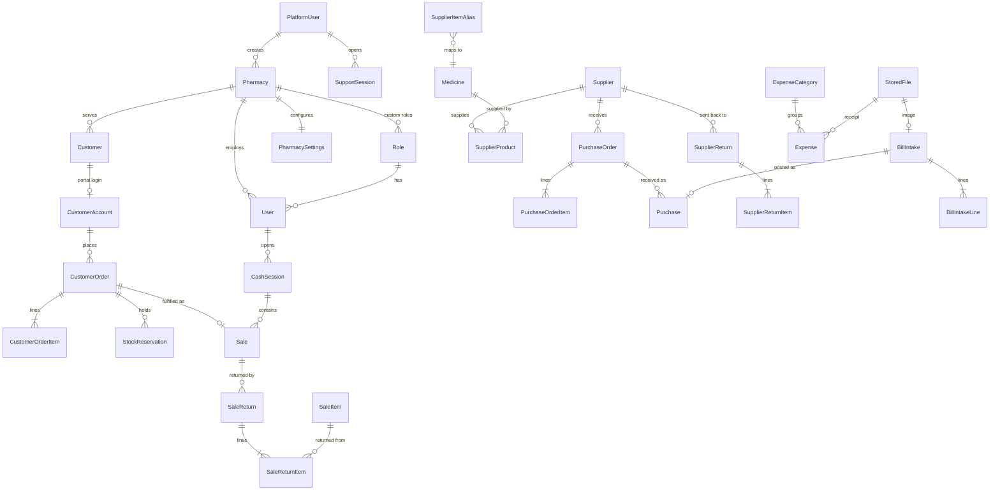

# 03. Data Model Changes

The current schema (14 tables) stays the core. This document lists every addition, the reason for it, and how to migrate without losing data. All money stays `Decimal(12,2)`, all keys stay UUID, and every new table that holds history is append-only.

The biggest change is **multi-tenancy**: almost every table gains a `pharmacyId` column protected by PostgreSQL Row-Level Security (section 2.2). Model snippets in sections 3 to 6 omit that column for readability; it is present on every one of them.

## 1. Overview of new and changed entities



## 2. Tenancy and identity

### 2.1 Pharmacy (the tenant)

```prisma
model Pharmacy {
  id               String         @id @default(uuid())
  slug             String         @unique          // used in /p/<slug>/login and /shop/<slug>
  name             String                          // display name, editable by Pharmacy Admin
  legalName        String?
  logoFileId       String?                         // StoredFile, resized 512 and 128 px
  brandColor       String?                         // hex, validated for contrast
  address          String         @default("")
  city             String?
  phone            String         @default("")
  whatsapp         String?
  email            String?
  licenseNumber    String?                         // drug sale licence, printed on bills
  taxNumber        String?
  status           PharmacyStatus @default(ACTIVE) // ACTIVE, GRACE, SUSPENDED, DEACTIVATED
  statusReason     String?
  plan             String         @default("STANDARD")
  subscriptionEndsAt DateTime?
  maxUsers         Int            @default(10)
  timezone         String         @default("Asia/Karachi")
  currency         String         @default("PKR")
  createdById      String                          // PlatformUser
  createdAt        DateTime       @default(now())
  updatedAt        DateTime       @updatedAt
}
```

Only Developer screens write `status`, `plan`, `subscriptionEndsAt`, `maxUsers` and `slug`. Pharmacy Admins edit the profile and branding fields.

### 2.2 Which tables are tenant tables

Every table below gets `pharmacyId String` (not null, FK to `Pharmacy`, indexed) and a Row-Level Security policy:

`User`, `Role` (custom roles only, see 2.4), `Category`, `Medicine`, `Batch`, `StockMovement`, `Customer`, `CustomerAccount`, `CustomerLedger`, `Supplier`, `SupplierLedger`, `SupplierProduct`, `SupplierItemAlias`, `Purchase`, `PurchaseItem`, `PurchaseOrder`, `PurchaseOrderItem`, `Sale`, `SaleItem`, `SaleReturn`, `SaleReturnItem`, `SupplierReturn`, `SupplierReturnItem`, `CashSession`, `CashMovement`, `CustomerOrder`, `CustomerOrderItem`, `OrderStatusEvent`, `StockReservation`, `Prescription`, `StoredFile`, `BillIntake`, `BillIntakeLine`, `ExpenseCategory`, `Expense`, `DailySummary`, `Notification`, `NotificationRead`, `AuditLog`, `OutboxEvent`, `IdempotencyKey`, `PharmacySettings`, `TenantCounter`, `FeatureFlag`.

Child tables (for example `SaleItem`) carry `pharmacyId` too, even though the parent has it. That keeps every RLS policy a simple column comparison with no joins, which is both faster and harder to get wrong.

Unique keys that are global today become per pharmacy:

| Today | After |
|---|---|
| `Sale.invoiceNo @unique` | `@@unique([pharmacyId, invoiceNo])` |
| `Purchase.number @unique` | `@@unique([pharmacyId, number])` |
| `Medicine.barcode @unique`, `Medicine.sku @unique` | `@@unique([pharmacyId, barcode])`, `@@unique([pharmacyId, sku])` |
| `Category.name @unique` | `@@unique([pharmacyId, name])` |
| `User.email @unique` | `@@unique([pharmacyId, username])`, email optional |
| `Batch @@unique([medicineId, batchNumber])` | unchanged (medicine already belongs to one pharmacy) |

RLS template applied to each tenant table in the migration:

```sql
ALTER TABLE "Sale" ENABLE ROW LEVEL SECURITY;
ALTER TABLE "Sale" FORCE ROW LEVEL SECURITY;
CREATE POLICY tenant_isolation ON "Sale"
  USING ("pharmacyId" = current_setting('app.pharmacy_id', true)::uuid)
  WITH CHECK ("pharmacyId" = current_setting('app.pharmacy_id', true)::uuid);
```

### 2.3 Accounts in three realms

```prisma
model PlatformUser {                       // Developer accounts, no pharmacyId
  id             String   @id @default(uuid())
  name           String
  email          String   @unique
  passwordHash   String
  totpSecret     String?                   // encrypted at rest; required before first use
  recoveryCodes  String[]                  // hashed
  sessionVersion Int      @default(1)
  lastLoginAt    DateTime?
  createdAt      DateTime @default(now())
  updatedAt      DateTime @updatedAt
}

model User {                               // pharmacy staff
  id                 String   @id @default(uuid())
  pharmacyId         String
  roleId             String
  name               String
  username           String                // unique inside the pharmacy
  email              String?
  phone              String?
  passwordHash       String?               // null until an invite is accepted
  mustChangePassword Boolean  @default(false)
  totpSecret         String?
  active             Boolean  @default(true)
  sessionVersion     Int      @default(1)
  failedLogins       Int      @default(0)
  lockedUntil        DateTime?
  lastLoginAt        DateTime?
  createdAt          DateTime @default(now())
  updatedAt          DateTime @updatedAt
  @@unique([pharmacyId, username])
}

model CustomerAccount {                    // customer portal login
  id             String   @id @default(uuid())
  pharmacyId     String
  customerId     String   @unique          // one login per customer record
  phone          String                    // login id, normalised to E.164
  passwordHash   String?
  active         Boolean  @default(true)
  sessionVersion Int      @default(1)
  failedLogins   Int      @default(0)
  lockedUntil    DateTime?
  lastLoginAt    DateTime?
  createdById    String
  createdAt      DateTime @default(now())
  @@unique([pharmacyId, phone])
}
```

There is deliberately **no API that writes `PlatformUser`** except the owner changing their own password and 2FA. The first row comes from `PLATFORM_OWNER_EMAIL` and `PLATFORM_OWNER_PASSWORD` on boot; recovery is the `platform:recover-owner` server command.

### 2.4 Roles

```prisma
model Role {
  id          String   @id @default(uuid())
  pharmacyId  String?                      // null = global system template
  key         String                       // PHARMACY_ADMIN, PHARMACIST, CASHIER, or custom slug
  name        String
  description String?
  system      Boolean  @default(false)     // templates are read-only
  permissions String[]                     // tenant permission catalog values only
  landingPath String   @default("/dashboard")
  createdAt   DateTime @default(now())
  updatedAt   DateTime @updatedAt
  @@unique([pharmacyId, key])
}
```

System templates are readable by every pharmacy (RLS policy allows `pharmacyId IS NULL` for SELECT only). A trigger blocks removing or deactivating the last active user holding `PHARMACY_ADMIN` in a pharmacy.

### 2.5 Tokens, 2FA and sessions

```prisma
model AuthToken {
  id          String    @id @default(uuid())
  realm       Realm                        // PLATFORM, STAFF, CUSTOMER
  subjectId   String                       // PlatformUser, User or CustomerAccount id
  pharmacyId  String?
  purpose     TokenPurpose                 // INVITE, RESET
  tokenHash   String    @unique            // sha256 of the random token; the token itself is never stored
  expiresAt   DateTime
  usedAt      DateTime?
  revokedAt   DateTime?
  createdByRealm Realm
  createdById String
  createdAt   DateTime  @default(now())
  @@index([subjectId, purpose])
}

model SupportSession {                     // Developer entering a pharmacy
  id          String    @id @default(uuid())
  platformUserId String
  pharmacyId  String
  reason      String
  startedAt   DateTime  @default(now())
  endedAt     DateTime?
}
```

`AuditLog` gains `realm` and `supportSessionId`, so every action in a support session is traceable and shown to the pharmacy as "Platform support".

### 2.6 Per-pharmacy settings, counters and flags

The single-row `Setting` table becomes `PharmacySettings` with `pharmacyId` as its primary key. Branding fields move to `Pharmacy`; operational settings stay here (see section 7.1).

```prisma
model TenantCounter {                      // replaces global sequences
  pharmacyId String
  key        String                        // INVOICE, PURCHASE, PO, RETURN, SUPPLIER_RETURN, EXPENSE, ORDER
  value      BigInt  @default(0)
  @@id([pharmacyId, key])
}

model FeatureFlag {
  pharmacyId String?                       // null = platform default
  key        String                        // ocr, purchaseOrders, cashSessions, returns, expenses, customerPortal
  enabled    Boolean @default(false)
  updatedAt  DateTime @updatedAt
  @@id([pharmacyId, key])
}
```

Effective flag = pharmacy row if present, otherwise the platform default. Only the Developer edits flags.

### 2.7 Supporting tables

```prisma
model IdempotencyKey {
  key        String   @id
  pharmacyId String
  actorId    String
  route      String
  status     Int
  response   Json
  createdAt  DateTime @default(now())    // purged after 24 h
}

model RateLimitHit {                     // not tenant scoped: login happens before a tenant is known
  bucket    String                       // e.g. "login:staff:<slug>:<username>", "login:ip:<ip>"
  at        DateTime @default(now())
  @@index([bucket, at])
}
```

## 3. Sales

### 3.1 Sale additions

| Field | Purpose |
|---|---|
| `customerName String?` | Walk-in name printed on the bill (R8) |
| `customerPhone String?` | Walk-in contact printed on the bill (R8), indexed for lookup |
| `cashSessionId String?` | Links cash and card sales to the cashier's drawer session |
| `changeGiven Decimal` | Cash tendered minus total, for drawer reconciliation |
| `receiptFormat String?` | Format used at print time, for identical reprints |

### 3.2 Cash sessions

```prisma
model CashSession {
  id            String    @id @default(uuid())
  userId        String
  status        CashSessionStatus @default(OPEN)   // OPEN, CLOSED
  openedAt      DateTime  @default(now())
  openingFloat  Decimal   @db.Decimal(12, 2)
  closedAt      DateTime?
  expectedCash  Decimal?  @db.Decimal(12, 2)       // computed at close
  countedCash   Decimal?  @db.Decimal(12, 2)
  difference    Decimal?  @db.Decimal(12, 2)
  note          String?
  closedById    String?
  sales         Sale[]
  movements     CashMovement[]
  @@index([userId, status])
}

model CashMovement {                 // pay-in and pay-out during a shift (e.g. petty cash)
  id         String   @id @default(uuid())
  sessionId  String
  type       CashMovementType      // PAY_IN, PAY_OUT, REFUND
  amount     Decimal  @db.Decimal(12, 2)
  reason     String
  userId     String
  createdAt  DateTime @default(now())
}
```

Constraint: a partial unique index allows only one `OPEN` session per user:
`CREATE UNIQUE INDEX one_open_session ON "CashSession"("userId") WHERE status = 'OPEN';`

### 3.3 Customer returns

```prisma
model SaleReturn {
  id          String   @id @default(uuid())
  number      String   @unique             // RET-YYYYMMDD-00001 from a sequence
  saleId      String
  userId      String
  approvedById String?
  refundMethod PaymentMethod                // CASH, CARD, CREDIT (credit note to ledger)
  total       Decimal  @db.Decimal(12, 2)
  reason      String
  createdAt   DateTime @default(now())
  items       SaleReturnItem[]
}

model SaleReturnItem {
  id          String  @id @default(uuid())
  returnId    String
  saleItemId  String                        // exact line, so price and batch are known
  batchId     String
  quantity    Int
  unitPrice   Decimal @db.Decimal(12, 2)
  costPrice   Decimal @db.Decimal(12, 2)
  restock     Boolean @default(true)        // false = damaged, goes to DAMAGE movement
  lineTotal   Decimal @db.Decimal(12, 2)
}
```

Rule enforced in service and by a check query: total returned quantity per `saleItemId` cannot exceed the sold quantity.

`MovementType` gains `SALE_RETURN` and `SUPPLIER_RETURN`.

## 4. Procurement

### 4.1 Supplier catalog (price list maintained by pharmacists)

```prisma
model SupplierProduct {
  supplierId    String
  medicineId    String
  supplierCode  String?
  lastPrice     Decimal? @db.Decimal(12, 2)
  lastBonusRule String?                    // e.g. "10+1"
  leadTimeDays  Int      @default(2)
  preferred     Boolean  @default(false)
  updatedAt     DateTime @updatedAt
  @@id([supplierId, medicineId])
}
```

Updated automatically whenever a purchase is posted, so it stays current without manual work. A partial unique index keeps one `preferred` supplier per medicine.

### 4.2 Purchase orders

```prisma
model PurchaseOrder {
  id            String   @id @default(uuid())
  number        String   @unique             // PO-YYYYMMDD-00001
  supplierId    String
  status        PurchaseOrderStatus          // DRAFT, SENT, PARTIALLY_RECEIVED, RECEIVED, CLOSED, CANCELLED
  source        String   @default("MANUAL")  // MANUAL or SUGGESTED
  expectedDate  DateTime? @db.Date
  note          String?
  estimatedTotal Decimal @db.Decimal(12, 2)
  createdById   String
  approvedById  String?
  sentAt        DateTime?
  createdAt     DateTime @default(now())
  updatedAt     DateTime @updatedAt
  items         PurchaseOrderItem[]
  purchases     Purchase[]
  @@index([supplierId, status])
}

model PurchaseOrderItem {
  id           String  @id @default(uuid())
  orderId      String
  medicineId   String
  orderedQty   Int
  receivedQty  Int     @default(0)
  expectedPrice Decimal? @db.Decimal(12, 2)
  @@unique([orderId, medicineId])
}
```

Check constraint: `receivedQty >= 0 AND receivedQty <= orderedQty * 2` (over-receipt allowed for bonus stock but bounded).

### 4.3 Purchase and purchase item additions

Pharmaceutical distributor bills in Pakistan usually show **bonus (free) quantity, trade discount and sales tax** per line. The current model has none of these, which makes OCR results impossible to post faithfully and makes cost price wrong when bonus stock arrives.

| Table | New field | Purpose |
|---|---|---|
| `Purchase` | `purchaseOrderId String?` | Link to the order it fulfils |
| `Purchase` | `intakeId String?` | Link to the OCR intake it came from |
| `Purchase` | `taxTotal Decimal` | Sales tax on the bill |
| `PurchaseItem` | `bonusQty Int @default(0)` | Free units, added to batch stock |
| `PurchaseItem` | `discountPercent Decimal` | Trade discount on the line |
| `PurchaseItem` | `taxAmount Decimal` | Line tax |
| `PurchaseItem` | `effectiveCost Decimal` | `lineTotal / (quantity + bonusQty)`, used as batch cost for profit |

Unique index `(supplierId, supplierInvoice)` where `supplierInvoice` is not null, to stop the same bill being entered twice.

### 4.4 Supplier returns

`SupplierReturn` and `SupplierReturnItem` mirror customer returns: they reference a batch, reduce stock with a `SUPPLIER_RETURN` movement and credit the supplier ledger. Main use: sending near-expiry stock back.

### 4.5 OCR intake

```prisma
model StoredFile {
  id         String   @id @default(uuid())
  key        String   @unique              // storage key, random
  purpose    String                        // BILL, PRESCRIPTION, EXPENSE_RECEIPT
  mime       String
  size       Int
  sha256     String
  uploadedById String
  createdAt  DateTime @default(now())
  @@index([sha256])
}

model BillIntake {
  id          String   @id @default(uuid())
  fileId      String   @unique
  supplierId  String?
  status      IntakeStatus                 // UPLOADED, PROCESSING, NEEDS_REVIEW, POSTED, FAILED, DISCARDED
  provider    String?
  rawResult   Json?                        // normalised provider output, kept for debugging and re-parsing
  header      Json?                        // { supplierName, invoiceNo, date, total, confidence }
  error       String?
  attempts    Int      @default(0)
  purchaseId  String?  @unique
  createdById String
  reviewedById String?
  createdAt   DateTime @default(now())
  updatedAt   DateTime @updatedAt
  lines       BillIntakeLine[]
  @@index([status, createdAt])
}

model BillIntakeLine {
  id          String   @id @default(uuid())
  intakeId    String
  lineNo      Int
  rawText     String
  name        String?
  batchNumber String?
  expiryDate  DateTime? @db.Date
  quantity    Int?
  bonusQty    Int?
  rate        Decimal?  @db.Decimal(12, 2)
  amount      Decimal?  @db.Decimal(12, 2)
  medicineId  String?
  matchMethod String?                      // BARCODE, ALIAS, TRIGRAM, MANUAL
  confidence  Float?                       // 0..1, lowest of field confidences
  ignored     Boolean  @default(false)     // reviewer removed the line
  @@unique([intakeId, lineNo])
}

model SupplierItemAlias {
  id          String   @id @default(uuid())
  supplierId  String?                      // null = global alias
  text        String                       // normalised: lower case, single spaces, no punctuation
  medicineId  String
  hits        Int      @default(1)
  updatedAt   DateTime @updatedAt
  @@unique([supplierId, text])
}
```

## 5. Customer orders

```prisma
model CustomerOrder {
  id            String      @id @default(uuid())
  pharmacyId    String
  number        String                          // ORD-YYYYMMDD-00001 from TenantCounter
  customerId    String
  accountId     String                          // CustomerAccount that placed it
  status        OrderStatus                     // PLACED, NEEDS_PRESCRIPTION, CONFIRMED, READY, OUT_FOR_DELIVERY, COMPLETED, REJECTED, CANCELLED
  fulfilment    String                          // PICKUP or DELIVERY
  deliveryAddress String?
  paymentChoice String                          // PAY_AT_PICKUP, CASH_ON_DELIVERY, ACCOUNT
  customerNote  String?
  estimatedTotal Decimal    @db.Decimal(12, 2)  // at placing time, informational
  confirmedTotal Decimal?   @db.Decimal(12, 2)  // locked at confirmation
  saleId        String?     @unique             // set when completed
  confirmedById String?
  rejectReason  String?
  createdAt     DateTime    @default(now())
  updatedAt     DateTime    @updatedAt
  items         CustomerOrderItem[]
  events        OrderStatusEvent[]
  @@unique([pharmacyId, number])
  @@index([pharmacyId, status, createdAt])
  @@index([customerId])
}

model CustomerOrderItem {
  id            String   @id @default(uuid())
  pharmacyId    String
  orderId       String
  medicineId    String
  quantity      Int
  lockedPrice   Decimal? @db.Decimal(12, 2)     // set at confirmation
  prescriptionId String?
  @@unique([orderId, medicineId])
}

model OrderStatusEvent {                        // timeline shown to customer and staff
  id         String   @id @default(uuid())
  pharmacyId String
  orderId    String
  from       OrderStatus?
  to         OrderStatus
  actorRealm Realm
  actorId    String
  note       String?
  at         DateTime @default(now())
}

model StockReservation {
  id         String   @id @default(uuid())
  pharmacyId String
  medicineId String
  orderId    String
  quantity   Int
  expiresAt  DateTime
  releasedAt DateTime?                          // set on completion, cancel or expiry
  @@index([pharmacyId, medicineId, releasedAt])
}

model Prescription {
  id           String   @id @default(uuid())
  pharmacyId   String
  customerId   String
  fileId       String                           // StoredFile, purpose PRESCRIPTION
  doctorName   String?
  issuedOn     DateTime? @db.Date
  status       String   @default("PENDING")    // PENDING, APPROVED, REJECTED
  reviewedById String?
  reviewNote   String?
  createdAt    DateTime @default(now())
}
```

Available to sell for a medicine = sum of non-expired batch quantity minus sum of unreleased, unexpired reservations. The POS search, the portal catalog and `createSale` all use this one function from the inventory module. When `createSale` is called for an order, that order's own reservation is excluded from the calculation and released in the same transaction.

`Medicine` gains `onlineVisible Boolean @default(false)` and `onlineDescription String?`. `Sale` gains `orderId String? @unique`.

## 6. Finance

```prisma
model ExpenseCategory {
  id     String @id @default(uuid())
  name   String @unique                    // Rent, Salaries, Electricity, Internet, Maintenance, Other
  active Boolean @default(true)
}

model Expense {
  id          String   @id @default(uuid())
  categoryId  String
  amount      Decimal  @db.Decimal(12, 2)
  date        DateTime @db.Date
  method      PaymentMethod
  description String
  receiptFileId String?
  cashSessionId String?                    // when paid from the drawer
  userId      String
  cancelledAt DateTime?                    // soft cancel, never deleted
  createdAt   DateTime @default(now())
  @@index([date])
}

model DailySummary {                       // maintained by report.rollup, rebuildable from source tables
  date          DateTime @id @db.Date
  grossSales    Decimal  @db.Decimal(14, 2)
  returns       Decimal  @db.Decimal(14, 2)
  discounts     Decimal  @db.Decimal(14, 2)
  cogs          Decimal  @db.Decimal(14, 2)
  stockLosses   Decimal  @db.Decimal(14, 2)
  expenses      Decimal  @db.Decimal(14, 2)
  purchases     Decimal  @db.Decimal(14, 2)
  invoiceCount  Int
  updatedAt     DateTime @updatedAt
}
```

## 7. Platform

Every model in this section carries `pharmacyId` as described in section 2.2. `AuditLog.pharmacyId` is nullable for Developer actions that are not inside a pharmacy (for example creating a pharmacy).

```prisma
model AuditLog {
  id               BigInt   @id @default(autoincrement())
  pharmacyId       String?
  at               DateTime @default(now())
  realm            Realm                     // PLATFORM, STAFF, CUSTOMER
  actorId          String?
  supportSessionId String?                   // set when the Developer acts inside a pharmacy
  action           String                    // e.g. sale.cancel, medicine.price.update, role.update, pharmacy.suspend
  entity           String
  entityId         String
  before           Json?
  after            Json?
  ip               String?
  userAgent        String?
  @@index([pharmacyId, entity, entityId])
  @@index([pharmacyId, at])
  @@index([actorId, at])
}

model OutboxEvent {
  id          BigInt    @id @default(autoincrement())
  pharmacyId  String?
  type        String
  payload     Json
  createdAt   DateTime  @default(now())
  processedAt DateTime?
  attempts    Int       @default(0)
  lastError   String?
  @@index([processedAt, id])
}

model Notification {
  id                 String   @id @default(uuid())
  pharmacyId         String?                 // null = platform notification for the Developer
  type               String                  // EXPIRY_30, EXPIRY_7, EXPIRED, LOW_STOCK, INTAKE_READY, PO_OVERDUE, CASH_DIFF, NEW_ORDER, RESET_REQUEST, SUBSCRIPTION
  severity           String                  // INFO, WARNING, CRITICAL
  title              String
  body               String
  link               String?
  audiencePermission String
  dedupeKey          String
  createdAt          DateTime @default(now())
  resolvedAt         DateTime?
  reads              NotificationRead[]
  @@unique([pharmacyId, dedupeKey])
}

model NotificationRead {
  notificationId String
  userId         String
  readAt         DateTime @default(now())
  @@id([notificationId, userId])
}
```

`AuditLog` hardening: `app_user` is granted `INSERT, SELECT` only on this table.

### 7.1 Pharmacy settings (operational)

`PharmacySettings` (one row per pharmacy) keeps the current settings fields that are not branding, plus:

| Field | Default | Notes |
|---|---|---|
| `expiryAlertDays` | 30 | From the notes; the existing `expiryWarningDays` (90) stays for the planning screen |
| `receiptFormat` | `THERMAL_80` | `THERMAL_80`, `THERMAL_58`, `A4` |
| `receiptHeader`, `invoiceFooter` | pharmacy name, existing footer | Editable by Pharmacy Admin |
| `autoPrintReceipt` | true | Print dialog opens after a sale |
| `cashDiffThreshold` | 100 | Difference that requires a note at shift close |
| `requireCashSession` | true | Cash sales blocked without an open session |
| `ocrProvider` | `LOCAL` | `LOCAL` or a cloud adapter key (allowed values controlled by the Developer) |
| `reorderCoverDays` | 7 | Used by reorder suggestions |
| `portalEnabled` | false | Customer portal on or off |
| `portalMaxOpenOrders` | 3 | Per customer |
| `reservationHours` | 24 | Lifetime of a confirmed order's stock reservation |
| `deliveryEnabled` | false | Shows the delivery option in the portal |

## 8. Indexes and search

```sql
CREATE EXTENSION IF NOT EXISTS pg_trgm;
CREATE INDEX medicine_name_trgm    ON "Medicine" USING gin (lower(name) gin_trgm_ops);
CREATE INDEX medicine_generic_trgm ON "Medicine" USING gin (lower("genericName") gin_trgm_ops);
CREATE INDEX customer_name_trgm    ON "Customer" USING gin (lower(name) gin_trgm_ops);
CREATE INDEX customer_phone_idx    ON "Customer" ("pharmacyId", phone);
CREATE INDEX sale_phone_idx        ON "Sale" ("pharmacyId", "customerPhone");
CREATE INDEX alias_text_trgm       ON "SupplierItemAlias" USING gin (text gin_trgm_ops);
CREATE INDEX batch_expiring        ON "Batch" ("pharmacyId", "expiryDate") WHERE quantity > 0;
```

Trigram indexes are not tenant-prefixed (GIN cannot lead with a uuid column efficiently without `btree_gin`). RLS filters the matches; with `btree_gin` installed, the indexes can become `(pharmacyId, lower(name))` when a single pharmacy grows beyond about 100k medicines.

## 9. Numbering

Global PostgreSQL sequences (`invoice_seq`, `purchase_seq`) are replaced by `TenantCounter` so each pharmacy has its own series starting at 1:

```sql
UPDATE "TenantCounter" SET value = value + 1
WHERE "pharmacyId" = $1 AND key = 'INVOICE'
RETURNING value;
```

Runs inside the sale transaction. The row lock serialises numbering only within one pharmacy. Number formats stay as today (`INV-YYYYMMDD-00001`), with new keys for `PO`, `RET`, `SRET`, `EXP` and `ORD`.

## 10. Migration rules

1. One Prisma migration per phase feature, never edit an applied migration.
2. Additive first (new nullable columns, new tables), backfill in the same migration with SQL, then tighten constraints in a follow-up migration.
3. Every migration is tested on a copy of production data before release (`pg_dump` then restore into a staging database, run `prisma migrate deploy`, run the smoke script and the tenant isolation suite).
4. Raw SQL that Prisma cannot express (RLS policies, partial indexes, check constraints, trigram indexes, grants) lives in the migration file with a comment explaining it, as the existing constraints migration already does.
5. Every new tenant table must ship with its `pharmacyId`, index and RLS policy in the same migration. A CI check queries `pg_tables` and fails if any table with a `pharmacyId` column has RLS disabled.

### 10.1 Moving the current single-shop data to multi-tenant

The existing installation becomes the first pharmacy. Done in Phase 1 in this order:

1. Create `Pharmacy`, `PlatformUser`, `TenantCounter`, `PharmacySettings`, `AuthToken`, `CustomerAccount`, `SupportSession`.
2. Insert one `Pharmacy` from the current `Setting` row (name, address, phone, email, currency) with a slug chosen at migration time.
3. Add nullable `pharmacyId` to every tenant table and backfill it with that pharmacy's id.
4. Seed `TenantCounter` from the current `invoice_seq` and `purchase_seq` values so numbering continues without gaps or duplicates.
5. Create role templates; map users: `ADMIN -> PHARMACY_ADMIN`, `PHARMACIST -> PHARMACIST`, `CASHIER -> CASHIER`; derive `username` from the email's local part.
6. Make `pharmacyId` not null, replace global unique keys with the per-pharmacy keys in section 2.2, drop the old `Role` enum, sequences and `Setting` table.
7. Enable RLS and create policies; create `app_user` and `platform_user` roles with their grants; switch `DATABASE_URL` to `app_user`.
8. Run the full test suite, the smoke script and the isolation suite against a restored copy before running it on the live database.
