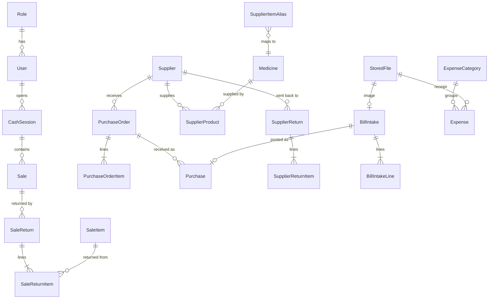

# 03. Data Model Changes

The current schema (14 tables) stays the core. This document lists every addition, the reason for it, and how to migrate without losing data. All money stays `Decimal(12,2)`, all keys stay UUID, and every new table that holds history is append-only.

## 1. Overview of new and changed entities



## 2. Identity

### 2.1 Role becomes a table

```prisma
model Role {
  id          String   @id @default(uuid())
  key         String   @unique          // DEVELOPER, SUPER_ADMIN, PHARMACIST, CASHIER, or custom slug
  name        String
  description String?
  system      Boolean  @default(false)  // system roles cannot be deleted or renamed
  hidden      Boolean  @default(false)  // DEVELOPER is hidden from non-developers
  permissions String[]                  // values from the code permission catalog
  landingPath String   @default("/dashboard")
  users       User[]
  createdAt   DateTime @default(now())
  updatedAt   DateTime @updatedAt
}
```

`User` changes:

| Field | Type | Purpose |
|---|---|---|
| `roleId` | String, FK | Replaces the `role` enum column |
| `sessionVersion` | Int, default 1 | Bumped on role change, deactivation or password reset to revoke sessions |
| `mustChangePassword` | Boolean | Forced change after seed or reset |
| `lastLoginAt` | DateTime? | Shown in user list, used for inactive account review |
| `phone` | String? | For OTP or WhatsApp notices later |

Migration (one release, no downtime needed for a single shop):

1. Create `Role`, seed four system roles with default permission sets.
2. Add nullable `roleId`; backfill: `ADMIN -> SUPER_ADMIN`, `PHARMACIST -> PHARMACIST`, `CASHIER -> CASHIER`.
3. Make `roleId` required, drop the old `role` column and the `Role` enum.
4. Create the Developer account from environment variables on first boot (`DEV_ADMIN_EMAIL`, `DEV_ADMIN_PASSWORD`), never from the seed file.

### 2.2 Supporting tables

```prisma
model IdempotencyKey {
  key        String   @id
  userId     String
  route      String
  status     Int
  response   Json
  createdAt  DateTime @default(now())   // purged after 24 h
}

model RateLimitHit {
  bucket    String                       // e.g. "login:ip:email"
  at        DateTime @default(now())
  @@index([bucket, at])
}
```

## 3. Sales

### 3.1 Sale additions

| Field | Purpose |
|---|---|
| `customerName String?` | Walk-in name printed on the bill (R8) |
| `customerPhone String?` | Walk-in contact printed on the bill (R8), indexed for lookup |
| `cashSessionId String?` | Links cash and card sales to the cashier's drawer session |
| `changeGiven Decimal` | Cash tendered minus total, for drawer reconciliation |
| `receiptFormat String?` | Format used at print time, for identical reprints |

### 3.2 Cash sessions

```prisma
model CashSession {
  id            String    @id @default(uuid())
  userId        String
  status        CashSessionStatus @default(OPEN)   // OPEN, CLOSED
  openedAt      DateTime  @default(now())
  openingFloat  Decimal   @db.Decimal(12, 2)
  closedAt      DateTime?
  expectedCash  Decimal?  @db.Decimal(12, 2)       // computed at close
  countedCash   Decimal?  @db.Decimal(12, 2)
  difference    Decimal?  @db.Decimal(12, 2)
  note          String?
  closedById    String?
  sales         Sale[]
  movements     CashMovement[]
  @@index([userId, status])
}

model CashMovement {                 // pay-in and pay-out during a shift (e.g. petty cash)
  id         String   @id @default(uuid())
  sessionId  String
  type       CashMovementType      // PAY_IN, PAY_OUT, REFUND
  amount     Decimal  @db.Decimal(12, 2)
  reason     String
  userId     String
  createdAt  DateTime @default(now())
}
```

Constraint: a partial unique index allows only one `OPEN` session per user:
`CREATE UNIQUE INDEX one_open_session ON "CashSession"("userId") WHERE status = 'OPEN';`

### 3.3 Customer returns

```prisma
model SaleReturn {
  id          String   @id @default(uuid())
  number      String   @unique             // RET-YYYYMMDD-00001 from a sequence
  saleId      String
  userId      String
  approvedById String?
  refundMethod PaymentMethod                // CASH, CARD, CREDIT (credit note to ledger)
  total       Decimal  @db.Decimal(12, 2)
  reason      String
  createdAt   DateTime @default(now())
  items       SaleReturnItem[]
}

model SaleReturnItem {
  id          String  @id @default(uuid())
  returnId    String
  saleItemId  String                        // exact line, so price and batch are known
  batchId     String
  quantity    Int
  unitPrice   Decimal @db.Decimal(12, 2)
  costPrice   Decimal @db.Decimal(12, 2)
  restock     Boolean @default(true)        // false = damaged, goes to DAMAGE movement
  lineTotal   Decimal @db.Decimal(12, 2)
}
```

Rule enforced in service and by a check query: total returned quantity per `saleItemId` cannot exceed the sold quantity.

`MovementType` gains `SALE_RETURN` and `SUPPLIER_RETURN`.

## 4. Procurement

### 4.1 Supplier price list

```prisma
model SupplierProduct {
  supplierId    String
  medicineId    String
  supplierCode  String?
  lastPrice     Decimal? @db.Decimal(12, 2)
  lastBonusRule String?                    // e.g. "10+1"
  leadTimeDays  Int      @default(2)
  preferred     Boolean  @default(false)
  updatedAt     DateTime @updatedAt
  @@id([supplierId, medicineId])
}
```

Updated automatically whenever a purchase is posted, so it stays current without manual work. A partial unique index keeps one `preferred` supplier per medicine.

### 4.2 Purchase orders

```prisma
model PurchaseOrder {
  id            String   @id @default(uuid())
  number        String   @unique             // PO-YYYYMMDD-00001
  supplierId    String
  status        PurchaseOrderStatus          // DRAFT, SENT, PARTIALLY_RECEIVED, RECEIVED, CLOSED, CANCELLED
  source        String   @default("MANUAL")  // MANUAL or SUGGESTED
  expectedDate  DateTime? @db.Date
  note          String?
  estimatedTotal Decimal @db.Decimal(12, 2)
  createdById   String
  approvedById  String?
  sentAt        DateTime?
  createdAt     DateTime @default(now())
  updatedAt     DateTime @updatedAt
  items         PurchaseOrderItem[]
  purchases     Purchase[]
  @@index([supplierId, status])
}

model PurchaseOrderItem {
  id           String  @id @default(uuid())
  orderId      String
  medicineId   String
  orderedQty   Int
  receivedQty  Int     @default(0)
  expectedPrice Decimal? @db.Decimal(12, 2)
  @@unique([orderId, medicineId])
}
```

Check constraint: `receivedQty >= 0 AND receivedQty <= orderedQty * 2` (over-receipt allowed for bonus stock but bounded).

### 4.3 Purchase and purchase item additions

Pharmaceutical distributor bills in Pakistan usually show **bonus (free) quantity, trade discount and sales tax** per line. The current model has none of these, which makes OCR results impossible to post faithfully and makes cost price wrong when bonus stock arrives.

| Table | New field | Purpose |
|---|---|---|
| `Purchase` | `purchaseOrderId String?` | Link to the order it fulfils |
| `Purchase` | `intakeId String?` | Link to the OCR intake it came from |
| `Purchase` | `taxTotal Decimal` | Sales tax on the bill |
| `PurchaseItem` | `bonusQty Int @default(0)` | Free units, added to batch stock |
| `PurchaseItem` | `discountPercent Decimal` | Trade discount on the line |
| `PurchaseItem` | `taxAmount Decimal` | Line tax |
| `PurchaseItem` | `effectiveCost Decimal` | `lineTotal / (quantity + bonusQty)`, used as batch cost for profit |

Unique index `(supplierId, supplierInvoice)` where `supplierInvoice` is not null, to stop the same bill being entered twice.

### 4.4 Supplier returns

`SupplierReturn` and `SupplierReturnItem` mirror customer returns: they reference a batch, reduce stock with a `SUPPLIER_RETURN` movement and credit the supplier ledger. Main use: sending near-expiry stock back.

### 4.5 OCR intake

```prisma
model StoredFile {
  id         String   @id @default(uuid())
  key        String   @unique              // storage key, random
  purpose    String                        // BILL, PRESCRIPTION, EXPENSE_RECEIPT
  mime       String
  size       Int
  sha256     String
  uploadedById String
  createdAt  DateTime @default(now())
  @@index([sha256])
}

model BillIntake {
  id          String   @id @default(uuid())
  fileId      String   @unique
  supplierId  String?
  status      IntakeStatus                 // UPLOADED, PROCESSING, NEEDS_REVIEW, POSTED, FAILED, DISCARDED
  provider    String?
  rawResult   Json?                        // normalised provider output, kept for debugging and re-parsing
  header      Json?                        // { supplierName, invoiceNo, date, total, confidence }
  error       String?
  attempts    Int      @default(0)
  purchaseId  String?  @unique
  createdById String
  reviewedById String?
  createdAt   DateTime @default(now())
  updatedAt   DateTime @updatedAt
  lines       BillIntakeLine[]
  @@index([status, createdAt])
}

model BillIntakeLine {
  id          String   @id @default(uuid())
  intakeId    String
  lineNo      Int
  rawText     String
  name        String?
  batchNumber String?
  expiryDate  DateTime? @db.Date
  quantity    Int?
  bonusQty    Int?
  rate        Decimal?  @db.Decimal(12, 2)
  amount      Decimal?  @db.Decimal(12, 2)
  medicineId  String?
  matchMethod String?                      // BARCODE, ALIAS, TRIGRAM, MANUAL
  confidence  Float?                       // 0..1, lowest of field confidences
  ignored     Boolean  @default(false)     // reviewer removed the line
  @@unique([intakeId, lineNo])
}

model SupplierItemAlias {
  id          String   @id @default(uuid())
  supplierId  String?                      // null = global alias
  text        String                       // normalised: lower case, single spaces, no punctuation
  medicineId  String
  hits        Int      @default(1)
  updatedAt   DateTime @updatedAt
  @@unique([supplierId, text])
}
```

## 5. Finance

```prisma
model ExpenseCategory {
  id     String @id @default(uuid())
  name   String @unique                    // Rent, Salaries, Electricity, Internet, Maintenance, Other
  active Boolean @default(true)
}

model Expense {
  id          String   @id @default(uuid())
  categoryId  String
  amount      Decimal  @db.Decimal(12, 2)
  date        DateTime @db.Date
  method      PaymentMethod
  description String
  receiptFileId String?
  cashSessionId String?                    // when paid from the drawer
  userId      String
  cancelledAt DateTime?                    // soft cancel, never deleted
  createdAt   DateTime @default(now())
  @@index([date])
}

model DailySummary {                       // maintained by report.rollup, rebuildable from source tables
  date          DateTime @id @db.Date
  grossSales    Decimal  @db.Decimal(14, 2)
  returns       Decimal  @db.Decimal(14, 2)
  discounts     Decimal  @db.Decimal(14, 2)
  cogs          Decimal  @db.Decimal(14, 2)
  stockLosses   Decimal  @db.Decimal(14, 2)
  expenses      Decimal  @db.Decimal(14, 2)
  purchases     Decimal  @db.Decimal(14, 2)
  invoiceCount  Int
  updatedAt     DateTime @updatedAt
}
```

## 6. Platform

```prisma
model AuditLog {
  id             BigInt   @id @default(autoincrement())
  at             DateTime @default(now())
  userId         String?
  impersonatedBy String?
  action         String                    // e.g. sale.cancel, medicine.price.update, role.update
  entity         String
  entityId       String
  before         Json?
  after          Json?
  ip             String?
  userAgent      String?
  @@index([entity, entityId])
  @@index([userId, at])
  @@index([at])
}

model OutboxEvent {
  id          BigInt    @id @default(autoincrement())
  type        String
  payload     Json
  createdAt   DateTime  @default(now())
  processedAt DateTime?
  attempts    Int       @default(0)
  lastError   String?
  @@index([processedAt, id])
}

model Notification {
  id                 String   @id @default(uuid())
  type               String                // EXPIRY_30, EXPIRY_7, EXPIRED, LOW_STOCK, INTAKE_READY, PO_OVERDUE, CASH_DIFF
  severity           String                // INFO, WARNING, CRITICAL
  title              String
  body               String
  link               String?
  audiencePermission String
  dedupeKey          String   @unique      // e.g. EXPIRY_30:batchId
  createdAt          DateTime @default(now())
  resolvedAt         DateTime?
  reads              NotificationRead[]
}

model NotificationRead {
  notificationId String
  userId         String
  readAt         DateTime @default(now())
  @@id([notificationId, userId])
}

model FeatureFlag {
  key       String  @id                    // ocr, purchaseOrders, cashSessions, returns, expenses
  enabled   Boolean @default(false)
  updatedAt DateTime @updatedAt
}
```

`AuditLog` hardening: the application database user is granted `INSERT, SELECT` only on this table.

### 6.1 Setting additions

| Field | Default | Notes |
|---|---|---|
| `expiryAlertDays` | 30 | From the notes; the existing `expiryWarningDays` (90) stays for the planning screen |
| `receiptFormat` | `THERMAL_80` | `THERMAL_80`, `THERMAL_58`, `A4` |
| `autoPrintReceipt` | true | Print dialog opens after a sale |
| `cashDiffThreshold` | 100 | Difference that requires a note at shift close |
| `requireCashSession` | true | Cash sales blocked without an open session |
| `ocrProvider` | `LOCAL` | `LOCAL` or a cloud adapter key |
| `reorderCoverDays` | 7 | Used by reorder suggestions |
| `taxNumber`, `licenseNumber` | empty | Printed on bills (drug sale licence) |

## 7. Indexes and search

```sql
CREATE EXTENSION IF NOT EXISTS pg_trgm;
CREATE INDEX medicine_name_trgm    ON "Medicine" USING gin (lower(name) gin_trgm_ops);
CREATE INDEX medicine_generic_trgm ON "Medicine" USING gin (lower("genericName") gin_trgm_ops);
CREATE INDEX customer_name_trgm    ON "Customer" USING gin (lower(name) gin_trgm_ops);
CREATE INDEX customer_phone_idx    ON "Customer" (phone);
CREATE INDEX sale_phone_idx        ON "Sale" ("customerPhone");
CREATE INDEX alias_text_trgm       ON "SupplierItemAlias" USING gin (text gin_trgm_ops);
CREATE INDEX batch_expiring        ON "Batch" ("expiryDate") WHERE quantity > 0;
```

## 8. Sequences

`po_seq`, `return_seq`, `supplier_return_seq`, `expense_seq` follow the existing `invoice_seq` pattern so numbers are unique under concurrency.

## 9. Migration rules

1. One Prisma migration per phase feature, never edit an applied migration.
2. Additive first (new nullable columns, new tables), backfill in the same migration with SQL, then tighten constraints in a follow-up migration.
3. Every migration is tested on a copy of production data before release (`pg_dump` then restore into a staging database, run `prisma migrate deploy`, run the smoke script).
4. Raw SQL that Prisma cannot express (partial indexes, check constraints, trigram indexes, grants) lives in the migration file with a comment explaining it, as the existing constraints migration already does.
