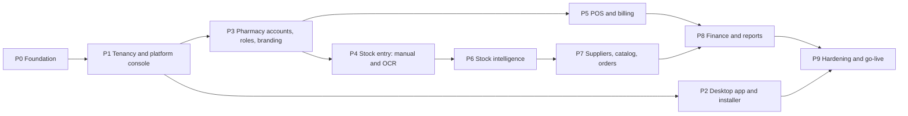

# 05. Implementation Roadmap

Ten phases. Each phase is a releasable increment: it ends with passing tests, a tagged release and a working app, so finished parts can be used while later phases are built.

The platform serves **small retail pharmacies** with walk-in customers. There are no customer logins or online orders. **Stock entry, both manual and by OCR of an uploaded picture, is a must-have** and is built early. The product installs on Windows as an `.exe` (desktop mode) and also runs as a hosted server (server mode) from the same code.

## 1. Phase order and dependencies

| Phase | Theme | Requirements covered | Estimate (1 developer) |
|---|---|---|---|
| P0 | Foundation | A10, groundwork for all | 5 days |
| P1 | Tenancy and platform console | R13, R17, R18, R19, A13, A16 | 8 days |
| P2 | Desktop app and installer (Windows `.exe`) | R18 in desktop mode, A9 (local backups), A11 | 5 days |
| P3 | Pharmacy accounts, roles and branding | R14, R15, R16, R20, R21, R22, A3 | 4 days |
| P4 | Stock entry: manual and OCR | R4, R5, R26 | 12 days |
| P5 | POS and billing | R6, R8, R9 (sales side), A1 (customer), A2 | 8 days |
| P6 | Stock intelligence | R1, R2, A4, A5 | 5 days |
| P7 | Suppliers, catalog and orders | R12, R25, R11 (data), A1 (supplier), A6, A7 | 8 days |
| P8 | Finance and reports | R3, R7, R10, R11, A12 | 5 days |
| P9 | Hardening and go-live | A9, A11, A14, A15, training | 6 days |
| | **Total** | | **about 13 to 14 weeks** |

Why this order:

- **Tenancy goes first after the foundation.** Adding `pharmacyId` and Row-Level Security to 14 tables is cheap now and very expensive after 25 more tables exist. Every later feature is built tenant-aware from its first line.
- **Desktop installer right after the platform console**, so the target flow (install the exe, Developer logs in, creates the pharmacy) works early, and every later phase is tested in both modes. A proof of concept in Phase 0 (task 0.12) removes the technical risk before any of this depends on it.
- **Accounts and roles before features**, because every new screen depends on the permission model and the role landing pages.
- **Stock entry before POS.** A new pharmacy's first job is loading its stock, and the requirement is that this works both manually and from a photo. Building OCR early also gives the longest possible time to collect real bills and tune accuracy before go-live.
- **Supplier catalogs and orders after stock entry**, so "receive against order" reuses the stock entry grid and supplier codes improve OCR matching.

**Early go-live option**: after P5, pull tasks 9.1 and 9.2 (backups, HTTPS) forward and onboard the first real pharmacy. It can load stock (manually or by OCR) and sell. P6 to P8 ship as updates to a live system.

## 2. Working conventions

- **Branches**: `main` is always deployable. One branch per phase (`phase-4-stock-entry`), short-lived feature branches inside it if needed. Merge with a clean history, then tag `v1.<phase>.0`.
- **Commits**: small, one logical change each, imperative subject line under 72 characters, body explains why. Commit at least once per completed task in the phase checklist, and tick the task in this file in the same commit.
- **Every phase ends with**: `npm run typecheck`, `npm run lint`, `npm test`, the tenant isolation suite, `npm run build`, the smoke script against a seeded app with two pharmacies, a manual click-through of changed screens in light and dark mode at phone and desktop widths, and docs updated.
- **Migrations**: one per feature, additive first, every tenant table with `pharmacyId` and RLS in the same migration, tested against a restored copy of real data (data model, section 9).
- **Feature flags**: OCR, purchase orders, cash sessions, returns and expenses ship behind per-pharmacy flags controlled from the platform console. Manual stock entry is always on.

---

## Phase 0: Foundation

**Goal**: a safe base for everything else, with no visible behaviour change for users.

Tasks:

- [x] 0.1 Upgrade Next.js to the maintained 15.5 line (15.5.27) with React 19, because 14.x is end of life and versions below 15.5.24 have a critical remote code execution flaw on Windows-hosted servers; override vulnerable transitive build tools; run the full test suite
- [ ] 0.2 GitHub Actions CI: install, typecheck, lint, integration tests against a PostgreSQL service container, build, `npm audit --audit-level=high`
- [ ] 0.3 Move `src/services/*` into `src/modules/<domain>/` with an `index.ts` per module; add `dependency-cruiser` rules for module boundaries
- [ ] 0.4 Make every service function accept a transaction client `tx` and a context object `{ actor, pharmacyId }` (pharmacyId is unused until P1 but the signatures are ready)
- [ ] 0.5 Add `AuditLog`, `OutboxEvent`, `IdempotencyKey`, `RateLimitHit` tables and helpers (`audit()`, `emit()`, `withIdempotency()`)
- [ ] 0.6 Wire audit and outbox into existing write paths: sale, cancel, purchase, adjustment, payments, medicine price change, user changes
- [ ] 0.7 Origin header check for non-GET API calls; move login rate limit to PostgreSQL
- [ ] 0.8 `pg_trgm` extension and trigram indexes
- [ ] 0.9 Worker entry point with pg-boss and the outbox dispatcher; `worker` service in `docker-compose.yml`
- [ ] 0.10 Design tokens as CSS variables, Fira Sans and Fira Code through `next/font`, split `components/ui.tsx` into one file per component
- [ ] 0.11 Structured logging (pino) and `/api/health` (database, queue, disk)
- [ ] 0.12 Desktop proof of concept: Next.js standalone build and embedded PostgreSQL started from an Electron main process on Windows; record start time, installed size and native module issues (Prisma engines, `pg`, OCR)

Acceptance criteria:

- All existing 18 integration tests and 47 smoke checks pass unchanged.
- A sale writes exactly one audit row and one outbox row in the same transaction (new test).
- Repeating a sale request with the same `Idempotency-Key` returns the same invoice and creates no second sale (new test).
- CI is green on a clean clone.
- The desktop proof of concept opens the login page from a locally started embedded PostgreSQL on Windows.

---

## Phase 1: Tenancy and platform console

**Goal**: the platform can host many pharmacies, and the Developer (you) can create and control them.

Tasks:

- [ ] 1.1 Migration part 1: `Pharmacy`, `PlatformUser`, `TenantCounter`, `PharmacySettings`, `AuthToken`, `SupportSession`, `FeatureFlag` (data model, sections 2.1 to 2.6)
- [ ] 1.2 Migration part 2: convert the current shop into the first pharmacy, backfill `pharmacyId`, per-pharmacy unique keys, counters seeded from current sequences (data model, section 9.1)
- [ ] 1.3 Migration part 3: RLS policies on every tenant table, `app_user` and `platform_user` database roles, CI check that fails if a tenant table has RLS disabled
- [ ] 1.4 `withTenant()` data access and the tenant-aware `route()` wrapper; replace global sequences with `TenantCounter` in sales and purchases
- [ ] 1.5 Identity realms: separate cookies and route wrappers for platform and staff, `realm` and `pharmacyId` in the JWT, `sessionVersion` checks
- [ ] 1.6 Developer bootstrap from `PLATFORM_OWNER_EMAIL` and `PLATFORM_OWNER_PASSWORD`, mandatory TOTP enrolment on first login with recovery codes, `npm run platform:recover-owner` server command
- [ ] 1.7 Auth tokens: create invite and reset links (hash only stored, expiry, single use, revoke on reissue), `/invite/<token>` and `/reset/<token>` pages, `mustChangePassword` flow
- [ ] 1.8 Platform console: overview, pharmacies list, new pharmacy form with first admin and one-time credentials panel (Copy, Share on WhatsApp, email adapter stub), pharmacy detail tabs
- [ ] 1.9 Pharmacy status (`ACTIVE`, `GRACE`, `SUSPENDED`, `DEACTIVATED`) enforced at login and on every request, with reason and re-auth
- [ ] 1.10 Accounts screen across pharmacies: activate, deactivate, generate reset link, force logout, unlock
- [ ] 1.11 Support sessions: enter a pharmacy with a reason, banner, audit with `supportSessionId`, end session
- [ ] 1.12 Per-pharmacy feature flags and limits editor (staff seats, OCR pages per month)
- [ ] 1.13 Per-pharmacy login page `/p/<slug>/login` and the generic `/login` with remembered pharmacy code
- [ ] 1.14 Tenant isolation test suite: two pharmacies, every endpoint called across tenants must return 404; runs in CI

Acceptance criteria:

- After migration, the existing shop's data, invoice numbering and logins work exactly as before inside "pharmacy 1".
- A query run as `app_user` without `app.pharmacy_id` set returns zero rows from every tenant table (test).
- The isolation suite passes for every API route.
- No API endpoint can create, edit, deactivate or delete a `PlatformUser`; verified by a test that lists all routes.
- Suspending a pharmacy logs out its staff on their next request; reactivating restores access with data intact.
- An invite link works once, expires after 72 hours, and a reissued link revokes the previous one.

---

## Phase 2: Desktop app and installer

**Goal**: a Windows `.exe` installer. After installing, the Developer logs in and creates the pharmacy; everything else works the same as server mode (architecture, section 2.3).

Tasks:

- [ ] 2.1 `desktop/` Electron main process: single-instance lock, splash screen with start-up progress, tray icon, main window, crash and log handling (logs in `%PROGRAMDATA%\PharmacyCRM\logs`)
- [ ] 2.2 Embedded PostgreSQL 16 lifecycle: initialise data directory, DPAPI-protected superuser password, create `app_owner`, `app_user`, `platform_user`, start, stop, restart on crash, free port selection, bind to `127.0.0.1` only
- [ ] 2.3 Next.js `output: "standalone"` build and a bundled worker, both started as child processes with Electron's Node; wait for `/api/health` before showing the window
- [ ] 2.4 Migrations on every start, with an automatic backup before any pending migration runs
- [ ] 2.5 Owner bootstrap from build-time secrets (email and password hash), forced TOTP enrolment, `PharmacyCRM.exe --recover-owner` for Windows administrators
- [ ] 2.6 electron-builder NSIS installer: install folder, Start menu and desktop shortcuts, private-network firewall rule, uninstall that keeps data unless the user ticks "remove data"
- [ ] 2.7 Client mode: "Connect to a pharmacy server" by LAN address or cloud URL, remembered per device
- [ ] 2.8 LAN access toggle for Pharmacy Admin with the address shown as a QR code for tablets
- [ ] 2.9 Local backup target (folder, USB drive, synced cloud folder) using the bundled `pg_dump`, with restore from the platform console
- [ ] 2.10 Release pipeline: GitHub Actions Windows runner builds and code-signs the installer, publishes it to the update feed; `electron-updater` checks on start and installs after a backup

Acceptance criteria:

- On a clean Windows 10 and Windows 11 machine, the installer runs, the first start finishes in under 60 seconds, the Developer logs in, enrols TOTP, creates a pharmacy, and its admin accepts the invite and makes a sale.
- Rebooting the PC keeps all data; the app starts again from the shortcut.
- Updating to a newer installer keeps all data and runs migrations after an automatic backup.
- A second PC in client mode, and a tablet browser with LAN access enabled, can log in to the same pharmacy.
- PostgreSQL is not reachable from another machine on the network.

---

## Phase 3: Pharmacy accounts, roles and branding

**Goal**: each pharmacy's admin runs their own team, roles and identity.

Tasks:

- [ ] 3.1 Role templates (Pharmacy Admin, Pharmacist, Cashier) and custom roles per pharmacy; "duplicate template"; no-escalation rule
- [ ] 3.2 Expanded tenant permission catalog (`cost.view`, `sales.reprint.any`, `cash.manage`, `po.approve`, `stockEntry.create`, `stockEntry.post`, `finance.view`, `audit.view`, `roles.manage`, `branding.manage`, `supplierCatalog.manage`)
- [ ] 3.3 Staff management: add with invite or temporary password, change role, deactivate, reset link, force logout, seat limit from the plan; guard against removing the last Pharmacy Admin
- [ ] 3.4 Optional TOTP for staff, required per pharmacy if the admin turns it on
- [ ] 3.5 Forgot password request from the login page routed to Pharmacy Admins as a notification
- [ ] 3.6 Profile and branding page with live preview: name, logo (resized versions), contacts, licence and tax numbers, receipt header and footer, brand colour with contrast check
- [ ] 3.7 Brand colour and logo applied to header, login page and receipts
- [ ] 3.8 Role landing paths: Cashier to POS, Pharmacist to pharmacist dashboard, Pharmacy Admin to owner dashboard
- [ ] 3.9 Cost and profit fields stripped in DTO mappers without `cost.view`
- [ ] 3.10 Audit log viewer for Pharmacy Admin, "History" tab on invoice, medicine, customer and supplier pages, support sessions labelled "Platform support"
- [ ] 3.11 Sidebar regrouped (Sell, Stock, Buy, People, Money, Admin) and filtered by permission

Acceptance criteria:

- A Pharmacy Admin can create a custom role, assign it, and the user's access changes on their next request.
- A cashier's API responses contain no `purchasePrice`, `costPrice` or profit fields (smoke check).
- The last active Pharmacy Admin cannot be deactivated or demoted (test).
- Changing the logo and colour updates the header, login page and next printed receipt.

---

## Phase 4: Stock entry, manual and OCR

**Goal**: staff bring stock in by typing it or by photographing a supplier bill or a stock list, review it on one screen, and post it.

Tasks, part A: manual entry and the shared draft (days 1 to 4):

- [ ] 4.1 Purchase line additions: bonus quantity, trade discount, tax, effective cost; unique supplier invoice number per supplier (data model, section 4.3)
- [ ] 4.2 `StockIntake`, `StockIntakePage`, `StockIntakeLine` and the `SE` counter (data model, section 4.5)
- [ ] 4.3 Stock entry list (drafts, needs review, posted) and the manual keyboard grid with autosave, inline "new medicine", warnings and blocking rules (architecture, section 6.1.1; UI plan, section 4.2)
- [ ] 4.4 Posting: `PURCHASE_BILL` through `createPurchase`; `STOCK_LIST` as opening batches with `OPENING` movements; one transaction; idempotency key
- [ ] 4.5 File import (Excel or CSV) into a draft, with a column mapping step, for opening stock and supplier price lists
- [ ] 4.6 Replace the old "New purchase" page with stock entry; keep the purchases list and detail pages

Tasks, part B: OCR (days 5 to 12):

- [ ] 4.7 `StorageAdapter` with local volume and S3-compatible implementations; protected file route; keys prefixed by pharmacy
- [ ] 4.8 Upload endpoint: magic byte check, size limit, hash de-duplication, multi-page, `StoredFile` and `StockIntakePage` rows
- [ ] 4.9 Phone upload screen: kind choice (bill or stock list), camera capture, crop and rotate, add page, client-side resize, progress, "you can leave this screen"
- [ ] 4.10 `OcrProvider` interface; local adapter (Tesseract) and one cloud adapter; allowed providers and monthly page limit per pharmacy from the platform console; usage counter
- [ ] 4.11 Normaliser to `ExtractedDocument`; bill parser (header fields, column mapping by header keywords, local number and date formats) and stock list parser (loose line formats, handwriting tolerant)
- [ ] 4.12 Matching pipeline: barcode, alias, trigram, manual (supplier codes join in P7); alias learning on post
- [ ] 4.13 OCR review on the same grid: photo pane with row highlight, confidence colouring, match tags, totals check, step indicator
- [ ] 4.14 Retry, failure fallback to manual grid with the photo beside it, discard, `files.cleanup` job, "ready for review" notification
- [ ] 4.15 Sample set (at least 20 real anonymised supplier bills and 5 stock list photos from pilot pharmacies) and an accuracy script reporting field-level accuracy per provider

Acceptance criteria:

- A 30-line supplier bill can be typed in the manual grid without using the mouse, and a refresh mid-way loses nothing.
- Posting a stock list creates opening batches and `OPENING` movements and writes nothing to any supplier ledger (integration test).
- Uploading the same photo twice returns the same draft; posting the same supplier invoice number twice for one supplier is rejected.
- No stock or ledger change happens before Post is pressed (integration test).
- When OCR fails or the monthly limit is reached, the user continues in the manual grid with the photo visible.
- On the sample set of printed bills, at least 85 percent of lines match the correct medicine without manual mapping after one week of alias learning; handwritten list accuracy is measured and reported, with no target yet.
- Batch cost with bonus stock equals line total divided by paid plus free units.

---

## Phase 5: POS and billing

**Goal**: faster counter sales, a proper retail bill with customer name and phone, cash accountability and returns.

Tasks:

- [ ] 5.1 Full-screen POS layout (`(pos)` route group) with the keyboard map from the UI plan
- [ ] 5.2 Walk-in `customerName` and `customerPhone` on sale; phone lookup suggests an existing customer; "save as customer"
- [ ] 5.3 Cash sessions: open with float, link sales, pay-in and pay-out, close with counted cash and difference note; Pharmacy Admin session list
- [ ] 5.4 Receipt data model and three templates (80 mm, 58 mm, A4) using pharmacy branding; auto print setting; QR code with invoice number
- [ ] 5.5 Batch and expiry printed on receipt lines (setting)
- [ ] 5.6 Customer returns: by invoice number or QR scan, partial quantities, restock or damaged, refund cash, card or credit note; return receipt
- [ ] 5.7 Cashier restrictions: own invoices only, reprint own, no cancel
- [ ] 5.8 Customer timeline (purchases, returns, payments) and medicine sales history
- [ ] 5.9 `Idempotency-Key` sent by the POS on complete sale

Acceptance criteria:

- A full sale with five items, cash payment and printed 80 mm receipt is possible without the mouse.
- Closing a session shows expected cash equal to opening float plus cash sales minus cash refunds plus pay-ins minus pay-outs (integration test).
- Returning more than was sold on a line is rejected (integration test).
- Returned restockable items go back to the original batch with a `SALE_RETURN` movement.

---

## Phase 6: Stock intelligence

**Goal**: nobody is surprised by expiry or empty shelves.

Tasks:

- [ ] 6.1 `expiryAlertDays` setting, default 30
- [ ] 6.2 `expiry.scan` and `stock.scan` jobs, fanned out per active pharmacy, with de-duplicated notifications (30 days, 7 days, expired; low stock, out of stock)
- [ ] 6.3 Notification bell and drawer; mark read; actions link to the fix
- [ ] 6.4 Expiry write-off flow (movement `EXPIRY`) and "mark for supplier return" list
- [ ] 6.5 Stock card report: opening, in by type, out by type, closing, per medicine and date range (R2)
- [ ] 6.6 Batch trace: which stock entries brought a batch in and which invoices sold it (for recalls)
- [ ] 6.7 Global search endpoint and Ctrl+K command palette
- [ ] 6.8 Medicine detail page: batches, stock card, price history, suppliers, history tab

Acceptance criteria:

- A batch expiring in 29 days generates one notification, not one per day (job test).
- Stock card closing balance equals the sum of batch quantities for the medicine (integration test).
- Command palette finds a medicine by partial generic name in under 150 ms on 20k medicines (benchmark script).

---

## Phase 7: Suppliers, catalog and orders

**Goal**: pharmacists keep each supplier's medicine list, and the pharmacy orders from suppliers ("list of available orders", "add order for each supplier").

Tasks:

- [ ] 7.1 `SupplierProduct` table; supplier page "Catalog" tab where pharmacists add existing medicines, create a new medicine inline and link it, set supplier code, pack, price, bonus rule, lead time, preferred
- [ ] 7.2 Supplier price list import through the file import from 4.5
- [ ] 7.3 `lastPrice` updated on every posted stock entry; supplier code added to the OCR matching pipeline
- [ ] 7.4 Purchase order CRUD and status machine (data model, section 4.2)
- [ ] 7.5 Reorder suggestions job and screen, "create one draft per supplier"
- [ ] 7.6 Supplier page "Orders" tab: open orders with ordered, received and pending quantities
- [ ] 7.7 Printable purchase order with pharmacy branding and WhatsApp share text
- [ ] 7.8 Receive against order: stock entry draft pre-filled from the PO (manual or OCR), partial receipts, close short
- [ ] 7.9 Supplier returns with ledger credit and `SUPPLIER_RETURN` movement
- [ ] 7.10 `po.overdue` job and notification

Acceptance criteria:

- A pharmacist can add a brand-new medicine to a supplier's catalog in one flow.
- Receiving 60 of 100 ordered units leaves the order `PARTIALLY_RECEIVED` with 40 pending; stock rises by 60 plus bonus.
- Creating a purchase order changes neither stock nor the supplier ledger (integration test).
- OCR match rate on the sample set improves once supplier codes are in the catalog (accuracy script).

---

## Phase 8: Finance and reports

**Goal**: real net profit and the daily and monthly views the owner asked for.

Tasks:

- [ ] 8.1 Expense categories and expenses (with optional receipt photo, optional link to cash session)
- [ ] 8.2 Profit and Loss report: net sales, COGS, gross profit, stock losses, expenses, net profit (architecture, section 6.5)
- [ ] 8.3 Report registry refactor of `/api/reports`
- [ ] 8.4 Daily and monthly sales with previous period comparison; by cashier, payment method, category
- [ ] 8.5 Daily and monthly purchases; by supplier; paid vs unpaid; entered manually vs by OCR
- [ ] 8.6 `DailySummary` rollup job and rebuild command
- [ ] 8.7 Excel export (`exceljs`) and print-to-PDF layouts with pharmacy branding for every report
- [ ] 8.8 Pharmacy Admin dashboard and pharmacist dashboard as designed in the UI plan
- [ ] 8.9 Platform usage figures on the Developer console (invoices per month, active users, OCR pages, storage per pharmacy)

Acceptance criteria:

- P&L for a month equals the sum of the daily figures (integration test).
- `DailySummary` rebuilt from scratch matches the incremental values.
- Cancelled sales and cancelled expenses are excluded from every report.

---

## Phase 9: Hardening and go-live

**Goal**: safe to run real businesses on, and easy to onboard new pharmacies.

Tasks:

- [ ] 9.1 Nightly backup job, offsite copy, retention, restore from the platform console, monthly restore drill documented
- [ ] 9.2 Caddy reverse proxy with HTTPS, production compose file, non-root image, resource limits
- [ ] 9.3 `subscription.check` job: `GRACE` and `SUSPENDED` transitions with banners and notifications
- [ ] 9.4 Per-pharmacy data export (ZIP of CSV and Excel files) from the platform console and on request by the Pharmacy Admin
- [ ] 9.5 PWA manifest and service worker for the staff app shell; install on counter tablets and pharmacists' phones (camera upload works from the installed app)
- [ ] 9.6 Playwright end-to-end journeys: Developer creates pharmacy and invite; admin accepts and sets branding; opening stock by photo with a fixture OCR result; supplier bill typed manually; cashier sale and receipt; return; close session; receive order
- [ ] 9.7 Accessibility audit (axe) on every screen; fix all serious issues
- [ ] 9.8 Performance check against the targets in the architecture document, with 20 pharmacies of seeded data
- [ ] 9.9 First-run wizard for a new pharmacy: profile and logo, receipt format, staff, opening stock (photo, file or manual), customers with credit balances, supplier balances
- [ ] 9.10 User guides per role (one page each), a printable keyboard shortcut card for POS and stock entry, and a Developer runbook (onboarding, suspension, recovery, restore)
- [ ] 9.11 Remove demo accounts from production setup; seed script only for development

Acceptance criteria:

- Restore of last night's backup into a fresh container succeeds and the smoke script passes against it.
- All Playwright journeys pass in CI.
- No serious or critical axe findings.
- A new pharmacy goes from "New pharmacy" in the console to its first sale in under 30 minutes, with opening stock loaded from a photo or file.

---

## 3. Start here: Phase 0 kickoff

The repository already has the baseline committed. To start building:

1. Create the phase branch: `git checkout -b phase-0-foundation`.
2. Do task 0.1 first (security upgrade), run `npm test`, `npm run build`, commit.
3. Do task 0.2 next so every following commit is checked by CI.
4. Work through 0.3 to 0.11 in order; 0.3 and 0.4 are pure refactors and must not change any test result.
5. Finish with the acceptance criteria, tick the boxes in this file, merge to `main`, tag `v1.0.0`.

Start collecting OCR samples now, in parallel with coding: ask pilot pharmacies for photos of 20 or more recent supplier bills and a few pages of their stock register. Phase 4 needs them, and real samples matter more than any parser design.

Environment variables introduced by the plan (added to `.env.example` in the phase that needs them):

| Variable | Phase | Purpose |
|---|---|---|
| `PLATFORM_OWNER_EMAIL`, `PLATFORM_OWNER_PASSWORD` | P1 | Creates the Developer account on first boot only |
| `PLATFORM_DATABASE_URL` | P1 | `platform_user` connection for cross-pharmacy console queries |
| `TOTP_ENCRYPTION_KEY` | P1 | Encrypts 2FA secrets at rest |
| `APP_BASE_URL` | P1 | Builds invite and reset links |
| `MAIL_*` (optional) | P1 | Email adapter for invites and resets |
| `STORAGE_DRIVER`, `S3_*` | P4 | File storage adapter for stock entry photos and logos |
| `OCR_PROVIDER`, provider keys | P4 | OCR adapters |
| `BACKUP_*` | P9 | Offsite backup target |
| `DEPLOY_MODE` | P0 | `server` or `desktop` |
| `OWNER_EMAIL_BUILD`, `OWNER_HASH_BUILD` (CI secrets) | P2 | Owner account baked into the desktop installer at build time |
| `CSC_LINK`, `CSC_KEY_PASSWORD` (CI secrets) | P2 | Code-signing certificate for the installer |

## 4. Risks and mitigations

| Risk | Likelihood | Impact | Mitigation |
|---|---|---|---|
| Data leak between pharmacies | Low | Very high | RLS fail-closed, non-owner database role, isolation suite in CI, CI check for RLS on new tables |
| Losing access to the Developer account | Low | High | TOTP recovery codes, server-only recovery command, documented runbook |
| Tenancy migration breaks the existing shop | Low | High | Tested on a restored copy, counters seeded from sequences, rollback plan from the pre-migration backup |
| OCR accuracy too low on local supplier bills | Medium | High | Mandatory review on the same grid, supplier codes and alias learning, supplier templates, provider swap through the adapter, manual entry always available |
| Handwritten stock lists read poorly | High | Medium | Cloud adapter for handwriting, loose-format parser, file import as an alternative for onboarding, accuracy measured on real samples |
| OCR cost grows with usage | Medium | Medium | Per-pharmacy monthly page limit set by the Developer, usage on the console, local adapter for clean printed bills |
| Counter staff resist the new POS | Medium | Medium | Keep the old POS route behind a flag for one release, shortcut card, short training |
| Thermal printer differences | Medium | Low | CSS templates tested on the actual printer models, 58 mm fallback, A4 always available |
| Desktop install issues (antivirus, SmartScreen, locked ports) | Medium | Medium | Code-signed installer, free port selection, embedded PostgreSQL on loopback only, clear start-up error screen with log export |
| Data loss | Low | Very high | Nightly offsite backups, restore drills, WAL archiving option |
| Scope creep mid-phase | High | Medium | New ideas go to the backlog and are scheduled at phase boundaries |

## 5. Backlog after go-live

- Shared master medicine catalog maintained by the Developer that pharmacies can import from (also improves OCR matching for new pharmacies)
- WhatsApp and SMS adapters for receipts and udhaar reminders
- Prescriptions with doctor directory and refill reminders
- Branches inside one pharmacy with stock transfer
- ESC/POS print agent with cash drawer kick
- Loyalty points
- Barcode label printing for loose items
- Upgrade path to Next.js 15 or later
