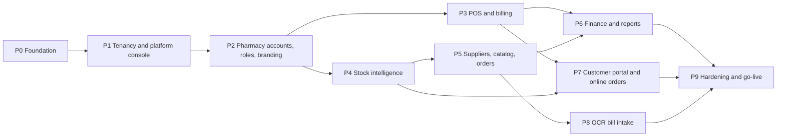

# 05. Implementation Roadmap

Ten phases. Each phase is a releasable increment: it ends with passing tests, a tagged release and a working app, so finished parts can be used while later phases are built.

## 1. Phase order and dependencies

| Phase | Theme | Requirements covered | Estimate (1 developer) |
|---|---|---|---|
| P0 | Foundation | A10, groundwork for all | 5 days |
| P1 | Tenancy and platform console | R13, R17, R18, R19, A13, A16 | 8 days |
| P2 | Pharmacy accounts, roles and branding | R14, R15, R16, R20, R21, R22, R23 (accounts), A3 | 5 days |
| P3 | POS and billing | R6, R8, R9 (sales side), A1 (customer), A2 | 8 days |
| P4 | Stock intelligence | R1, R2, R5, A4, A5 | 5 days |
| P5 | Suppliers, catalog and orders | R12, R25, R11 (data), A1 (supplier), A6, A7 | 8 days |
| P6 | Finance and reports | R3, R7, R10, R11, A12 | 5 days |
| P7 | Customer portal and online orders | R23, R24, A8 | 10 days |
| P8 | OCR bill intake | R4 | 10 days |
| P9 | Hardening and go-live | A9, A11, A14, A15, data import, training | 6 days |
| | **Total** | | **about 14 weeks** |

Why this order:

- **Tenancy goes first after the foundation.** Adding `pharmacyId` and Row-Level Security to 14 tables is cheap now and very expensive after 30 more tables exist. Every later feature is then built tenant-aware from its first line.
- **Accounts and roles before features**, because every new screen depends on the permission model and the role landing pages.
- **Customer portal after POS, stock and orders**, because a completed online order becomes a normal sale (P3), uses reservations on top of stock availability (P4) and must respect purchase data (P5).
- **OCR after supplier orders**, because a scanned bill must post bonus quantity, tax and receive against an order.

**Early go-live option**: after P5, pull tasks 9.1 and 9.2 (backups, HTTPS) forward and onboard the first real pharmacy. P6 to P8 then ship as updates to a live system, which gives real bills for OCR testing and real feedback on the portal.

## 2. Working conventions

- **Branches**: `main` is always deployable. One branch per phase (`phase-1-tenancy`), short-lived feature branches inside it if needed. Merge with a clean history, then tag `v1.<phase>.0`.
- **Commits**: small, one logical change each, imperative subject line under 72 characters, body explains why. Commit at least once per completed task in the phase checklist, and tick the task in this file in the same commit.
- **Every phase ends with**: `npm run typecheck`, `npm run lint`, `npm test`, the tenant isolation suite, `npm run build`, the smoke script against a seeded app with two pharmacies, a manual click-through of changed screens in light and dark mode at phone and desktop widths, and docs updated.
- **Migrations**: one per feature, additive first, every tenant table with `pharmacyId` and RLS in the same migration, tested against a restored copy of real data (data model, section 10).
- **Feature flags**: OCR, purchase orders, cash sessions, returns, expenses and the customer portal ship behind per-pharmacy flags controlled from the platform console.

---

## Phase 0: Foundation

**Goal**: a safe base for everything else, with no visible behaviour change for users.

Tasks:

- [ ] 0.1 Upgrade Next.js to the latest patched 14.2.x and `eslint-config-next` to match; run the full test suite
- [ ] 0.2 GitHub Actions CI: install, typecheck, lint, integration tests against a PostgreSQL service container, build, `npm audit --audit-level=high`
- [ ] 0.3 Move `src/services/*` into `src/modules/<domain>/` with an `index.ts` per module; add `dependency-cruiser` rules for module boundaries
- [ ] 0.4 Make every service function accept a transaction client `tx` and a context object `{ actor, pharmacyId }` (pharmacyId is unused until P1 but the signatures are ready)
- [ ] 0.5 Add `AuditLog`, `OutboxEvent`, `IdempotencyKey`, `RateLimitHit` tables and helpers (`audit()`, `emit()`, `withIdempotency()`)
- [ ] 0.6 Wire audit and outbox into existing write paths: sale, cancel, purchase, adjustment, payments, medicine price change, user changes
- [ ] 0.7 Origin header check for non-GET API calls; move login rate limit to PostgreSQL
- [ ] 0.8 `pg_trgm` extension and trigram indexes
- [ ] 0.9 Worker entry point with pg-boss and the outbox dispatcher; `worker` service in `docker-compose.yml`
- [ ] 0.10 Design tokens as CSS variables, Fira Sans and Fira Code through `next/font`, split `components/ui.tsx` into one file per component
- [ ] 0.11 Structured logging (pino) and `/api/health` (database, queue, disk)

Acceptance criteria:

- All existing 18 integration tests and 47 smoke checks pass unchanged.
- A sale writes exactly one audit row and one outbox row in the same transaction (new test).
- Repeating a sale request with the same `Idempotency-Key` returns the same invoice and creates no second sale (new test).
- CI is green on a clean clone.

---

## Phase 1: Tenancy and platform console

**Goal**: the platform can host many pharmacies, and the Developer (you) can create and control them.

Tasks:

- [ ] 1.1 Migration part 1: `Pharmacy`, `PlatformUser`, `TenantCounter`, `PharmacySettings`, `AuthToken`, `SupportSession`, `FeatureFlag` (data model, sections 2.1 to 2.6)
- [ ] 1.2 Migration part 2: convert the current shop into the first pharmacy, backfill `pharmacyId`, per-pharmacy unique keys, counters seeded from current sequences (data model, section 10.1)
- [ ] 1.3 Migration part 3: RLS policies on every tenant table, `app_user` and `platform_user` database roles, CI check that fails if a tenant table has RLS disabled
- [ ] 1.4 `withTenant()` data access and the tenant-aware `route()` wrapper; replace global sequences with `TenantCounter` in sales and purchases
- [ ] 1.5 Identity realms: separate cookies and route wrappers for platform and staff (customer realm comes in P2), `realm` and `pharmacyId` in the JWT, `sessionVersion` checks
- [ ] 1.6 Developer bootstrap from `PLATFORM_OWNER_EMAIL` and `PLATFORM_OWNER_PASSWORD`, mandatory TOTP enrolment on first login with recovery codes, `npm run platform:recover-owner` server command
- [ ] 1.7 Auth tokens: create invite and reset links (hash only stored, expiry, single use, revoke on reissue), `/invite/<token>` and `/reset/<token>` pages, `mustChangePassword` flow
- [ ] 1.8 Platform console: overview, pharmacies list, new pharmacy form with first admin and one-time credentials panel (Copy, Share on WhatsApp, email adapter stub), pharmacy detail tabs
- [ ] 1.9 Pharmacy status (`ACTIVE`, `GRACE`, `SUSPENDED`, `DEACTIVATED`) enforced at login and on every request, with reason and re-auth
- [ ] 1.10 Accounts screen across pharmacies: activate, deactivate, generate reset link, force logout, unlock
- [ ] 1.11 Support sessions: enter a pharmacy with a reason, banner, audit with `supportSessionId`, end session
- [ ] 1.12 Per-pharmacy feature flags editor
- [ ] 1.13 Per-pharmacy login page `/p/<slug>/login` and the generic `/login` with remembered pharmacy code
- [ ] 1.14 Tenant isolation test suite: two pharmacies, every endpoint called across tenants must return 404; runs in CI

Acceptance criteria:

- After migration, the existing shop's data, invoice numbering and logins work exactly as before inside "pharmacy 1".
- A query run as `app_user` without `app.pharmacy_id` set returns zero rows from every tenant table (test).
- The isolation suite passes for every API route.
- No API endpoint can create, edit, deactivate or delete a `PlatformUser`; verified by a test that lists all routes.
- Suspending a pharmacy logs out its staff on their next request; reactivating restores access with data intact.
- An invite link works once, expires after 72 hours, and a reissued link revokes the previous one.

---

## Phase 2: Pharmacy accounts, roles and branding

**Goal**: each pharmacy's admin runs their own team, roles and identity.

Tasks:

- [ ] 2.1 Role templates (Pharmacy Admin, Pharmacist, Cashier) and custom roles per pharmacy; "duplicate template"; no-escalation rule
- [ ] 2.2 Expanded tenant permission catalog (`cost.view`, `sales.reprint.any`, `cash.manage`, `po.approve`, `ocr.review`, `finance.view`, `audit.view`, `roles.manage`, `branding.manage`, `supplierCatalog.manage`, `orders.fulfil`, `customers.accounts`)
- [ ] 2.3 Staff management: add with invite or temporary password, change role, deactivate, reset link, force logout, seat limit from the plan; guard against removing the last Pharmacy Admin
- [ ] 2.4 Optional TOTP for staff, required per pharmacy if the admin turns it on
- [ ] 2.5 Forgot password request from the login page routed to Pharmacy Admins as a notification
- [ ] 2.6 Profile and branding page with live preview: name, logo (resized versions), contacts, licence and tax numbers, receipt header and footer, brand colour with contrast check
- [ ] 2.7 Brand colour and logo applied to header, login page and receipts
- [ ] 2.8 Role landing paths: Cashier to POS, Pharmacist to pharmacist dashboard, Pharmacy Admin to owner dashboard
- [ ] 2.9 Cost and profit fields stripped in DTO mappers without `cost.view`
- [ ] 2.10 Customer realm and `CustomerAccount`: "Create portal login" on the customer page, invite or temporary password, status, reset link (the portal itself comes in P7; this task only lets customers log in and see a placeholder home)
- [ ] 2.11 Audit log viewer for Pharmacy Admin, "History" tab on invoice, medicine, customer and supplier pages, support sessions labelled "Platform support"
- [ ] 2.12 Sidebar regrouped (Sell, Stock, Buy, People, Money, Admin) and filtered by permission

Acceptance criteria:

- A Pharmacy Admin can create a custom role, assign it, and the user's access changes on their next request.
- A cashier's API responses contain no `purchasePrice`, `costPrice` or profit fields (smoke check).
- The last active Pharmacy Admin cannot be deactivated or demoted (test).
- Changing the logo and colour updates the header, login page and next printed receipt.
- A customer account can log in only on its own pharmacy's portal URL.

---

## Phase 3: POS and billing

**Goal**: faster counter sales, a proper retail bill with customer name and phone, cash accountability and returns.

Tasks:

- [ ] 3.1 Full-screen POS layout (`(pos)` route group) with the keyboard map from the UI plan
- [ ] 3.2 Walk-in `customerName` and `customerPhone` on sale; phone lookup suggests an existing customer; "save as customer"
- [ ] 3.3 Cash sessions: open with float, link sales, pay-in and pay-out, close with counted cash and difference note; Pharmacy Admin session list
- [ ] 3.4 Receipt data model and three templates (80 mm, 58 mm, A4) using pharmacy branding; auto print setting; QR code with invoice number
- [ ] 3.5 Batch and expiry printed on receipt lines (setting)
- [ ] 3.6 Customer returns: by invoice number or QR scan, partial quantities, restock or damaged, refund cash, card or credit note; return receipt
- [ ] 3.7 Cashier restrictions: own invoices only, reprint own, no cancel
- [ ] 3.8 Customer timeline (purchases, returns, payments) and medicine sales history
- [ ] 3.9 `Idempotency-Key` sent by the POS on complete sale

Acceptance criteria:

- A full sale with five items, cash payment and printed 80 mm receipt is possible without the mouse.
- Closing a session shows expected cash equal to opening float plus cash sales minus cash refunds plus pay-ins minus pay-outs (integration test).
- Returning more than was sold on a line is rejected (integration test).
- Returned restockable items go back to the original batch with a `SALE_RETURN` movement.

---

## Phase 4: Stock intelligence

**Goal**: nobody is surprised by expiry or empty shelves.

Tasks:

- [ ] 4.1 `expiryAlertDays` setting, default 30
- [ ] 4.2 `expiry.scan` and `stock.scan` jobs, fanned out per active pharmacy, with de-duplicated notifications (30 days, 7 days, expired; low stock, out of stock)
- [ ] 4.3 Notification bell and drawer; mark read; actions link to the fix
- [ ] 4.4 Expiry write-off flow (movement `EXPIRY`) and "mark for supplier return" list
- [ ] 4.5 Stock card report: opening, in by type, out by type, closing, per medicine and date range (R2)
- [ ] 4.6 Batch trace: which purchases brought a batch in and which invoices sold it (for recalls)
- [ ] 4.7 Single "available to sell" function in the inventory module (ready for reservations in P7)
- [ ] 4.8 Global search endpoint and Ctrl+K command palette
- [ ] 4.9 Medicine detail page: batches, stock card, price history, suppliers, history tab

Acceptance criteria:

- A batch expiring in 29 days generates one notification, not one per day (job test).
- Stock card closing balance equals the sum of batch quantities for the medicine (integration test).
- Command palette finds a medicine by partial generic name in under 150 ms on 20k medicines (benchmark script).

---

## Phase 5: Suppliers, catalog and orders

**Goal**: pharmacists keep each supplier's medicine list, and the pharmacy orders from suppliers ("list of available orders", "add order for each supplier").

Tasks:

- [ ] 5.1 `SupplierProduct` table; supplier page "Catalog" tab where pharmacists add existing medicines, create a new medicine inline and link it, set supplier code, pack, price, bonus rule, lead time, preferred
- [ ] 5.2 Supplier price list import (CSV or Excel) with preview and error report
- [ ] 5.3 Purchase line additions: bonus quantity, trade discount, tax, effective cost; unique supplier invoice number per supplier; `lastPrice` updated on posting
- [ ] 5.4 Purchase order CRUD and status machine (data model, section 4.2)
- [ ] 5.5 Reorder suggestions job and screen, "create one draft per supplier"
- [ ] 5.6 Supplier page "Orders" tab: open orders with ordered, received and pending quantities
- [ ] 5.7 Printable purchase order with pharmacy branding and WhatsApp share text
- [ ] 5.8 Receive against order: pre-filled purchase form, partial receipts, close short
- [ ] 5.9 Supplier returns with ledger credit and `SUPPLIER_RETURN` movement
- [ ] 5.10 `po.overdue` job and notification

Acceptance criteria:

- A pharmacist can add a brand-new medicine to a supplier's catalog in one flow.
- Receiving 60 of 100 ordered units leaves the order `PARTIALLY_RECEIVED` with 40 pending; stock rises by 60 plus bonus.
- Creating a purchase order changes neither stock nor the supplier ledger (integration test).
- Entering the same supplier invoice number twice for one supplier is rejected.
- Batch cost with bonus stock equals line total divided by paid plus free units.

---

## Phase 6: Finance and reports

**Goal**: real net profit and the daily and monthly views the owner asked for.

Tasks:

- [ ] 6.1 Expense categories and expenses (with optional receipt photo, optional link to cash session)
- [ ] 6.2 Profit and Loss report: net sales, COGS, gross profit, stock losses, expenses, net profit (architecture, section 6.5)
- [ ] 6.3 Report registry refactor of `/api/reports`
- [ ] 6.4 Daily and monthly sales with previous period comparison; by cashier, payment method, category, channel (counter or online)
- [ ] 6.5 Daily and monthly purchases; by supplier; paid vs unpaid
- [ ] 6.6 `DailySummary` rollup job and rebuild command
- [ ] 6.7 Excel export (`exceljs`) and print-to-PDF layouts with pharmacy branding for every report
- [ ] 6.8 Pharmacy Admin dashboard and pharmacist dashboard as designed in the UI plan
- [ ] 6.9 Platform usage figures on the Developer console (invoices per month, active users, storage per pharmacy)

Acceptance criteria:

- P&L for a month equals the sum of the daily figures (integration test).
- `DailySummary` rebuilt from scratch matches the incremental values.
- Cancelled sales and cancelled expenses are excluded from every report.

---

## Phase 7: Customer portal and online orders

**Goal**: customers with an account order from their phone; staff confirm, prepare and hand over.

Tasks:

- [ ] 7.1 Portal shell at `/shop/<slug>`: branding, mobile layout, bottom navigation, PWA manifest per pharmacy
- [ ] 7.2 `onlineVisible` flag on medicines (bulk toggle) and the portal catalog with search, categories and "Order again"
- [ ] 7.3 Cart and checkout: pickup or delivery, payment choice, note, idempotent submit, open order limit
- [ ] 7.4 Prescriptions: upload from cart, pharmacist approve or reject, `NEEDS_PRESCRIPTION` state
- [ ] 7.5 `CustomerOrder`, items, status events; staff order board (kanban and list) with sound and badges
- [ ] 7.6 Confirm creates `StockReservation` and locks prices; availability everywhere uses "stock minus reservations"
- [ ] 7.7 Hand over and delivery completion create the sale through `createSale` with the order's prices; reservation released in the same transaction
- [ ] 7.8 Cancel, reject and `orders.expireReservations` job
- [ ] 7.9 Portal "Me": profile, invoices, balance and ledger, change password
- [ ] 7.10 Rate limits on portal login and ordering; staff one-click disable of a portal account

Acceptance criteria:

- An order confirmed for 10 units reduces POS availability by 10 until it is completed or cancelled.
- Completing an order creates exactly one sale with FEFO batches and the locked prices (integration test).
- An expired reservation is released by the job and staff are notified.
- A customer cannot see or act on another customer's orders, nor any data from another pharmacy (isolation suite extended to the customer realm).

---

## Phase 8: OCR bill intake

**Goal**: a pharmacist photographs a supplier bill on a phone and posts it after a quick review.

Tasks:

- [ ] 8.1 `StorageAdapter` with local volume and S3-compatible implementations; protected file route; keys prefixed by pharmacy
- [ ] 8.2 Upload endpoint: magic byte check, size limit, hash de-duplication, `StoredFile` and `BillIntake` rows
- [ ] 8.3 Mobile upload screen: camera capture, crop and rotate, multi-page, client-side resize, progress
- [ ] 8.4 `OcrProvider` interface; local adapter (Tesseract) and one cloud adapter; allowed providers per pharmacy set by the Developer
- [ ] 8.5 Normaliser to `ExtractedDocument` and line parser (header keyword column mapping, number and date parsing for local formats)
- [ ] 8.6 Matching pipeline: barcode, supplier code from the catalog, supplier alias, trigram, manual; alias learning on confirm
- [ ] 8.7 Review screen with image highlight, confidence colouring, totals check, PO linking
- [ ] 8.8 Posting through `createPurchase` (and PO receive) in one transaction; intake marked `POSTED`
- [ ] 8.9 Retry, failure and discard handling; `files.cleanup` job
- [ ] 8.10 Sample bill set (at least 20 real anonymised bills) and an accuracy script reporting field-level accuracy per provider

Acceptance criteria:

- Uploading the same photo twice returns the same intake.
- No stock or ledger change happens before the reviewer presses Post (integration test).
- On the sample set, at least 85 percent of lines match the correct medicine without manual mapping after one week of alias learning.
- A bill can always be finished manually if OCR fails.

---

## Phase 9: Hardening and go-live

**Goal**: safe to run real businesses on, and easy to onboard new pharmacies.

Tasks:

- [ ] 9.1 Nightly backup job, offsite copy, retention, restore from the platform console, monthly restore drill documented
- [ ] 9.2 Caddy reverse proxy with HTTPS (wildcard or per-domain), production compose file, non-root image, resource limits
- [ ] 9.3 `subscription.check` job: `GRACE` and `SUSPENDED` transitions with banners and notifications
- [ ] 9.4 Per-pharmacy data export (ZIP of CSV and Excel files) from the platform console and on request by the Pharmacy Admin
- [ ] 9.5 PWA service worker for the staff app shell; install on counter tablets and phones
- [ ] 9.6 Playwright end-to-end journeys: Developer creates pharmacy and invite; admin accepts and sets branding; cashier sale and receipt; return; close session; receive order; customer places order and staff completes it; OCR review with a fixture result
- [ ] 9.7 Accessibility audit (axe) on every screen; fix all serious issues
- [ ] 9.8 Performance check against the targets in the architecture document, with 20 pharmacies of seeded data
- [ ] 9.9 Import tools in the first-run wizard: medicines and opening stock, customers, supplier balances from Excel or CSV with preview and error report
- [ ] 9.10 User guides per role (one page each), a printable keyboard shortcut card, and a Developer runbook (onboarding, suspension, recovery, restore)
- [ ] 9.11 Remove demo accounts from production setup; seed script only for development

Acceptance criteria:

- Restore of last night's backup into a fresh container succeeds and the smoke script passes against it.
- All Playwright journeys pass in CI.
- No serious or critical axe findings.
- A new pharmacy goes from "New pharmacy" in the console to its first sale in under 30 minutes using the import tools.

---

## 3. Start here: Phase 0 kickoff

The repository already has the baseline committed. To start building:

1. Create the phase branch: `git checkout -b phase-0-foundation`.
2. Do task 0.1 first (security upgrade), run `npm test`, `npm run build`, commit.
3. Do task 0.2 next so every following commit is checked by CI.
4. Work through 0.3 to 0.11 in order; 0.3 and 0.4 are pure refactors and must not change any test result.
5. Finish with the acceptance criteria, tick the boxes in this file, merge to `main`, tag `v1.0.0`.

Environment variables introduced by the plan (added to `.env.example` in the phase that needs them):

| Variable | Phase | Purpose |
|---|---|---|
| `PLATFORM_OWNER_EMAIL`, `PLATFORM_OWNER_PASSWORD` | P1 | Creates the Developer account on first boot only |
| `PLATFORM_DATABASE_URL` | P1 | `platform_user` connection for cross-pharmacy console queries |
| `TOTP_ENCRYPTION_KEY` | P1 | Encrypts 2FA secrets at rest |
| `APP_BASE_URL` | P1 | Builds invite, reset and portal links |
| `MAIL_*` (optional) | P1 | Email adapter for invites and resets |
| `STORAGE_DRIVER`, `S3_*` | P8 | File storage adapter |
| `OCR_PROVIDER`, provider keys | P8 | OCR adapter |
| `BACKUP_*` | P9 | Offsite backup target |

## 4. Risks and mitigations

| Risk | Likelihood | Impact | Mitigation |
|---|---|---|---|
| Data leak between pharmacies | Low | Very high | RLS fail-closed, non-owner database role, isolation suite in CI, CI check for RLS on new tables |
| Losing access to the Developer account | Low | High | TOTP recovery codes, server-only recovery command, documented runbook |
| Tenancy migration breaks the existing shop | Low | High | Tested on a restored copy, counters seeded from sequences, rollback plan from the pre-migration backup |
| OCR accuracy too low on local supplier bills | Medium | Medium | Mandatory review, supplier codes and alias learning, provider swap through adapter, manual entry always available |
| Online orders oversell counter stock | Medium | Medium | Reservations counted in one availability function used by POS, portal and sales |
| Counter staff resist the new POS | Medium | Medium | Keep the old POS route behind a flag for one release, shortcut card, short training |
| Thermal printer differences | Medium | Low | CSS templates tested on the actual printer models, 58 mm fallback, A4 always available |
| Data loss | Low | Very high | Nightly offsite backups, restore drills, WAL archiving option |
| Scope creep mid-phase | High | Medium | New ideas go to the backlog and are scheduled at phase boundaries |

## 5. Backlog after go-live

- Online payments in the customer portal (payment gateway adapter)
- Customer self-registration with staff approval
- WhatsApp and SMS adapters for receipts, order updates and udhaar reminders
- Branches inside one pharmacy with stock transfer
- Shared master medicine catalog maintained by the Developer that pharmacies can import from
- ESC/POS print agent with cash drawer kick
- Loyalty points
- Barcode label printing for loose items
- Upgrade path to Next.js 15 or later
