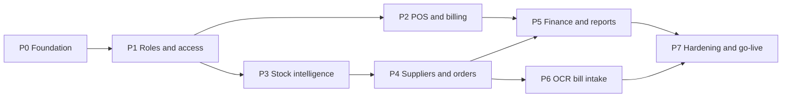

# 05. Implementation Roadmap

Eight phases. Each phase is a releasable increment: it ends with passing tests, a tagged release and a working app, so the pharmacy can start using finished parts while later phases are built.

## 1. Phase order and dependencies

| Phase | Theme | Requirements covered | Estimate (1 developer) |
|---|---|---|---|
| P0 | Foundation | A10, groundwork for all | 5 days |
| P1 | Roles and access | R13, R14, R15, R16, A3 | 5 days |
| P2 | POS and billing | R6, R8, R9 (sales side), A1 (customer), A2 | 8 days |
| P3 | Stock intelligence | R1, R2, R5, A4, A5 | 5 days |
| P4 | Suppliers and orders | R12, R11 (data), A1 (supplier), A6, A7 | 8 days |
| P5 | Finance and reports | R3, R7, R10, R11, A12 | 5 days |
| P6 | OCR bill intake | R4, A8 groundwork | 10 days |
| P7 | Hardening and go-live | A9, A11, data import, training | 5 days |
| | **Total** | | **about 10 to 11 weeks** |

Why this order: roles come first because every later screen depends on the new permission model. OCR comes after purchase orders because a scanned bill must be able to post bonus quantity, tax and receive against an order; building OCR first would mean rebuilding its posting step. Finance needs returns (P2) and supplier data (P4) to calculate net profit correctly.

## 2. Working conventions

- **Branches**: `main` is always deployable. One branch per phase (`phase-1-roles`), short-lived feature branches inside it if needed. Merge with a squash or a clean history, then tag `v1.<phase>.0`.
- **Commits**: small, one logical change each, imperative subject line under 72 characters, body explains why. Commit at least once per completed task in the phase checklist.
- **Every phase ends with**: `npm run typecheck`, `npm run lint`, `npm test`, `npm run build`, smoke script against a seeded app, manual click-through of changed screens in light and dark mode at phone and desktop widths, and the README or docs updated.
- **Migrations**: one per feature, additive first, tested against a restored copy of real data before release (see data model, section 9).
- **Feature flags**: OCR, purchase orders, cash sessions, returns and expenses ship behind flags so a half-adopted feature never confuses counter staff.

---

## Phase 0: Foundation

**Goal**: a safe base for everything else, with no visible behaviour change for users.

Tasks:

- [ ] 0.1 Upgrade Next.js to the latest patched 14.2.x and `eslint-config-next` to match; run the full test suite
- [ ] 0.2 GitHub Actions CI: install, typecheck, lint, unit and integration tests against a PostgreSQL service container, build, `npm audit --audit-level=high`
- [ ] 0.3 Move `src/services/*` into `src/modules/<domain>/` with an `index.ts` per module; add `dependency-cruiser` rules for module boundaries
- [ ] 0.4 Make every service function accept an optional transaction client `tx`
- [ ] 0.5 Add `AuditLog`, `OutboxEvent`, `IdempotencyKey`, `RateLimitHit`, `FeatureFlag` tables and helpers (`audit()`, `emit()`, `withIdempotency()`)
- [ ] 0.6 Wire audit and outbox into existing write paths: sale, cancel, purchase, adjustment, payments, medicine price change, user changes
- [ ] 0.7 Origin header check for non-GET API calls; move login rate limit to PostgreSQL
- [ ] 0.8 Add `pg_trgm` extension and trigram indexes
- [ ] 0.9 Worker entry point with pg-boss and the outbox dispatcher; add `worker` service to `docker-compose.yml`
- [ ] 0.10 Design tokens as CSS variables, Fira Sans and Fira Code through `next/font`, split `components/ui.tsx` into one file per component
- [ ] 0.11 Structured logging (pino) and `/api/health` (database, queue, disk)

Acceptance criteria:

- All existing 18 integration tests and 47 smoke checks pass unchanged.
- A sale writes exactly one audit row and one outbox row in the same transaction (new test).
- Repeating a sale request with the same `Idempotency-Key` returns the same invoice and creates no second sale (new test).
- CI is green on a clean clone.

---

## Phase 1: Roles and access

**Goal**: the four roles from the notes, each landing on its own home screen.

Tasks:

- [ ] 1.1 Migration: `Role` table, seed system roles, backfill `roleId`, drop the enum (data model, section 2.1)
- [ ] 1.2 Expand the permission catalog (`cost.view`, `sales.reprint.any`, `cash.manage`, `po.approve`, `ocr.review`, `finance.view`, `system.console`, `audit.view`, `roles.manage`)
- [ ] 1.3 `sessionVersion` revocation, `mustChangePassword` flow, `lastLoginAt`
- [ ] 1.4 Developer account bootstrap from environment variables; hide developer users and the console from other roles
- [ ] 1.5 Role landing paths: Cashier to `/pos`, Pharmacist to `/dashboard/pharmacist`, Super Admin to `/dashboard`, Developer to `/system`
- [ ] 1.6 Cost and profit fields stripped in DTO mappers without `cost.view`
- [ ] 1.7 Users and Roles screens: list, create, edit permissions with grouped checkboxes, deactivate, reset password (re-auth required)
- [ ] 1.8 Audit log viewer with filters; "History" tab on invoice, medicine, customer and supplier pages
- [ ] 1.9 Developer console v1: health, feature flags, maintenance mode banner
- [ ] 1.10 Sidebar regrouped (Sell, Stock, Buy, People, Money, Admin) and filtered by permission

Acceptance criteria:

- A cashier's API responses contain no `purchasePrice`, `costPrice` or profit fields (smoke check).
- Changing a user's role logs them out on their next request.
- Super Admin cannot see, edit or deactivate the Developer account.
- Each role lands on its own page after login.

---

## Phase 2: POS and billing

**Goal**: faster counter sales, a proper retail bill with customer name and phone, cash accountability and returns.

Tasks:

- [ ] 2.1 Full-screen POS layout (`(pos)` route group) with the keyboard map from the UI plan
- [ ] 2.2 Walk-in `customerName` and `customerPhone` on sale; phone lookup suggests an existing customer; "save as customer"
- [ ] 2.3 Cash sessions: open with float, link sales, pay-in and pay-out, close with counted cash and difference note; Super Admin session list
- [ ] 2.4 Receipt data model and three templates (80 mm, 58 mm, A4); settings for format and auto print; QR code with invoice number
- [ ] 2.5 Batch and expiry printed on receipt lines (setting)
- [ ] 2.6 Customer returns: by invoice number or QR scan, partial quantities, restock or damaged, refund cash, card or credit note; return receipt
- [ ] 2.7 Cashier restrictions: own invoices only, reprint own, no cancel
- [ ] 2.8 Customer timeline (purchases, returns, payments) and medicine sales history
- [ ] 2.9 `Idempotency-Key` sent by the POS on complete sale

Acceptance criteria:

- A full sale with five items, cash payment and printed 80 mm receipt is possible without the mouse.
- Closing a session shows expected cash equal to opening float plus cash sales minus cash refunds plus pay-ins minus pay-outs (integration test).
- Returning more than was sold on a line is rejected (integration test).
- Returned restockable items go back to the original batch with a `SALE_RETURN` movement.

---

## Phase 3: Stock intelligence

**Goal**: nobody is surprised by expiry or empty shelves.

Tasks:

- [ ] 3.1 `expiryAlertDays` setting, default 30
- [ ] 3.2 `expiry.scan` and `stock.scan` jobs with de-duplicated notifications (30 days, 7 days, expired; low stock, out of stock)
- [ ] 3.3 Notification bell and drawer; mark read; actions link to the fix
- [ ] 3.4 Expiry write-off flow (movement `EXPIRY`) and "mark for supplier return" list
- [ ] 3.5 Stock card report: opening, in by type, out by type, closing, per medicine and date range (R2)
- [ ] 3.6 Batch trace: which purchases brought a batch in and which invoices sold it (for recalls)
- [ ] 3.7 Global search endpoint and Ctrl+K command palette
- [ ] 3.8 Medicine detail page: batches, stock card, price history, suppliers, history tab

Acceptance criteria:

- A batch expiring in 29 days generates one notification, not one per day (job test).
- Stock card closing balance equals the sum of batch quantities for the medicine (integration test over seeded data).
- Command palette finds a medicine by partial generic name in under 150 ms on 20k medicines (benchmark script).

---

## Phase 4: Suppliers and orders

**Goal**: the "list of available orders" and "add order for each supplier" from the notes, plus faithful purchase entry.

Tasks:

- [ ] 4.1 `SupplierProduct` table, updated on every posted purchase; preferred supplier per medicine
- [ ] 4.2 Purchase line additions: bonus quantity, trade discount, tax, effective cost; unique supplier invoice number per supplier
- [ ] 4.3 Purchase order CRUD and status machine (data model, section 4.2)
- [ ] 4.4 Reorder suggestions job and screen, "create one draft per supplier"
- [ ] 4.5 Supplier page "Orders" tab: open orders with ordered, received and pending quantities
- [ ] 4.6 Printable purchase order and WhatsApp share text
- [ ] 4.7 Receive against order: pre-filled purchase form, partial receipts, close short
- [ ] 4.8 Supplier returns with ledger credit and `SUPPLIER_RETURN` movement
- [ ] 4.9 `po.overdue` job and notification

Acceptance criteria:

- Receiving 60 of 100 ordered units leaves the order `PARTIALLY_RECEIVED` with 40 pending; stock rises by 60 plus bonus.
- Creating a purchase order changes neither stock nor the supplier ledger (integration test).
- Entering the same supplier invoice number twice for one supplier is rejected.
- Batch cost with bonus stock equals line total divided by paid plus free units.

---

## Phase 5: Finance and reports

**Goal**: real net profit and the daily and monthly views the owner asked for.

Tasks:

- [ ] 5.1 Expense categories and expenses (with optional receipt photo, optional link to cash session)
- [ ] 5.2 Profit and Loss report: net sales, COGS, gross profit, stock losses, expenses, net profit (architecture, section 6.5)
- [ ] 5.3 Report registry refactor of `/api/reports`
- [ ] 5.4 Daily and monthly sales with previous period comparison; by cashier, payment method, category
- [ ] 5.5 Daily and monthly purchases; by supplier; paid vs unpaid
- [ ] 5.6 `DailySummary` rollup job and rebuild command
- [ ] 5.7 Excel export (`exceljs`) and print-to-PDF layouts for every report
- [ ] 5.8 Owner dashboard and pharmacist dashboard as designed in the UI plan

Acceptance criteria:

- P&L for a month equals the sum of the daily figures (integration test).
- `DailySummary` rebuilt from scratch matches the incremental values.
- Cancelled sales and cancelled expenses are excluded from every report.

---

## Phase 6: OCR bill intake

**Goal**: a pharmacist photographs a supplier bill on a phone and posts it after a quick review.

Tasks:

- [ ] 6.1 `StorageAdapter` with local volume and S3-compatible implementations; protected file route
- [ ] 6.2 Upload endpoint: magic byte check, size limit, hash de-duplication, `StoredFile` and `BillIntake` rows
- [ ] 6.3 Mobile upload screen: camera capture, crop and rotate, multi-page, client-side resize, progress
- [ ] 6.4 `OcrProvider` interface; local adapter (Tesseract) and one cloud adapter; provider selected in settings
- [ ] 6.5 Normaliser to `ExtractedDocument` and line parser (header keyword column mapping, number and date parsing for local formats)
- [ ] 6.6 Matching pipeline: barcode, supplier alias, trigram, manual; alias learning on confirm
- [ ] 6.7 Review screen with image highlight, confidence colouring, totals check, PO linking
- [ ] 6.8 Posting through `createPurchase` (and PO receive) in one transaction; intake marked `POSTED`
- [ ] 6.9 Retry, failure and discard handling; `files.cleanup` job
- [ ] 6.10 Sample bill set (at least 20 real anonymised bills from the pharmacy's suppliers) and an accuracy script that reports field-level accuracy per provider

Acceptance criteria:

- Uploading the same photo twice returns the same intake.
- No stock or ledger change happens before the reviewer presses Post (integration test).
- On the sample set, at least 85 percent of lines match the correct medicine without manual mapping after one week of alias learning (measured by the accuracy script).
- A bill can always be finished manually if OCR fails.

---

## Phase 7: Hardening and go-live

**Goal**: safe to run a real business on.

Tasks:

- [ ] 7.1 Nightly backup job, offsite copy, retention, restore from the developer console, monthly restore drill documented
- [ ] 7.2 Caddy reverse proxy with HTTPS; production compose file; non-root image; resource limits
- [ ] 7.3 PWA manifest and service worker for app shell caching; install on counter tablets and phones
- [ ] 7.4 Playwright end-to-end tests for the main journeys: login per role, sale and receipt, return, close session, receive order, OCR review with a fixture result
- [ ] 7.5 Accessibility audit (axe) on every screen; fix all serious issues
- [ ] 7.6 Performance check against the targets in the architecture document
- [ ] 7.7 Import tools: medicines and opening stock from Excel or CSV with a preview and error report; customers and supplier balances
- [ ] 7.8 User guide per role (one page each) and a printable keyboard shortcut card for the counter
- [ ] 7.9 Remove demo accounts from production setup; first-run wizard (pharmacy details, Super Admin account, receipt format)

Acceptance criteria:

- Restore of last night's backup into a fresh container succeeds and the smoke script passes against it.
- All Playwright journeys pass in CI.
- No serious or critical axe findings.
- A new pharmacy can be set up from an empty database to first sale in under 30 minutes using the import tools.

---

## 3. Risks and mitigations

| Risk | Likelihood | Impact | Mitigation |
|---|---|---|---|
| OCR accuracy too low on local supplier bills | Medium | Medium | Mandatory review, alias learning, supplier templates, manual entry always available, provider swap through adapter |
| Role migration locks someone out | Low | High | Backfill in the same migration, developer bootstrap account, tested on a data copy |
| Counter staff resist the new POS | Medium | Medium | Keep the old POS route behind a flag for one release, shortcut card, short training |
| Thermal printer differences | Medium | Low | CSS templates tested on the actual printer model, 58 mm fallback, A4 always available |
| Data loss | Low | Very high | Nightly offsite backups, restore drills, WAL archiving option |
| Scope creep from new ideas mid-phase | High | Medium | New ideas go to a backlog file and are scheduled at phase boundaries |

## 4. Backlog after go-live

- ESC/POS print agent with cash drawer kick
- WhatsApp receipt and udhaar reminder messages
- Prescriptions with doctor directory and refill reminders
- Multi-branch stock and transfers
- Loyalty points
- Barcode label printing for loose items
- Upgrade path to Next.js 15 or later
